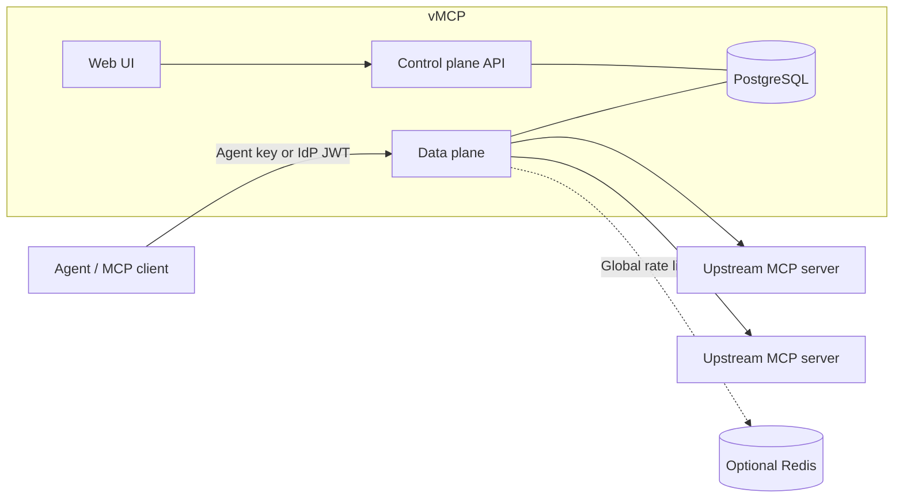

<div align="center">

# vMCP

**An open-source gateway for the Model Context Protocol.**

Register upstream MCP servers once, then select their tools, resources and prompts
into virtual MCP servers: one endpoint per agent or team.

[](https://github.com/bishoku/vmcp/actions/workflows/ci.yml)
[](LICENSE)

</div>

## Why vMCP?

Give each agent the capabilities it needs without distributing upstream credentials.
Use the web UI or REST API to compose virtual servers, rename capabilities and
manage access from one place.

- **Control access:** agent keys, identity-provider JWTs, tool policies and rate limits.
- **Protect data:** encrypted upstream credentials and configurable PII masking.
- **Investigate activity:** audit records and independent HTTPS, Kafka or RabbitMQ export.
- **Handle failures:** health checks, circuit breakers and bounded retries for eligible tools.
- **Scale out:** multiple data planes share PostgreSQL state; Redis is optional for global rate limits.

Upstreams must expose HTTP endpoints (Streamable HTTP or legacy HTTP+SSE).
vMCP does not launch local stdio servers. Client connections use Streamable HTTP,
with the **2025-06-18** protocol baseline and negotiated optional features.

## Choose your starting point

| Goal | Guide |
|---|---|
| Try the UI with bundled sample MCP servers | [Getting started](docs/Getting-Started.md) |
| Run a smaller local stack with your own upstream | [Local Docker installation](docs/Deployment.md#local-docker-installation) |
| Try vMCP on an existing development Kubernetes cluster | [Kubernetes quickstart](docs/HELM_QUICKSTART.md) |
| Install a published version | [Release installation](docs/Release-Installation.md) |
| Plan a production deployment | [Production deployment](docs/PRODUCTION_DEPLOYMENT.md) |

For the guided local demo, clone the repository and start the sandbox:

```sh
git clone https://github.com/bishoku/vmcp.git
cd vmcp
docker compose -f benchmark/compose.yaml up -d --build
```

Requires Docker with Compose, roughly 6–8 GiB available memory and internet access
for the initial build. Open **http://localhost:3300** and sign in with the local demo
admin token `demo-admin-token`. The sandbox uses public development credentials;
use it locally. Follow [Getting started](docs/Getting-Started.md) to register a
sample upstream, create a virtual server and connect with an agent key.

## How it works



The control plane manages configuration; the data plane serves
`/mcp/v1/virtual/{slug}`. PostgreSQL holds configuration, shared session/delivery
state and audit records. Physical upstream connections and some caches remain
local to each node. See [Architecture](docs/Architecture.md).

## Documentation

Start at the [documentation home](docs/Home.md), also published as the
[GitHub Wiki](https://github.com/bishoku/vmcp/wiki).

- [Guided setup and client connection](docs/Connections-and-Setup.md)
- [Upstreams](docs/Upstreams.md) and [virtual servers](docs/Virtual-Servers.md)
- [Authentication](docs/Agent-Keys-and-Authentication.md), [SSO and roles](docs/SSO-and-RBAC.md), [security](docs/Security.md)
- [Audit log](docs/Audit-Log.md), [observability](docs/OBSERVABILITY.md), [troubleshooting](docs/FAQ.md)
- [Configuration reference](docs/Configuration.md), [REST API and GitOps](docs/REST-API.md), [protocol compatibility](docs/MCP_PROTOCOL_CONTRACT.md)

## Status and limits

vMCP is **Beta / development**; APIs may change. There is no declared production
SLA or compliance certification. Production use requires deployment-specific
load, failover, backup/restore and security validation described in the
[production guide](docs/PRODUCTION_DEPLOYMENT.md).

PII masking is configurable regex inspection, not a guarantee against data leaks
or prompt injection. Ambiguous side-effecting operations must be reconciled before
retrying. Tenant isolation uses dedicated plane/database deployments.
See [known limitations](docs/FAQ.md#known-limitations).

## Contributing

Read [CONTRIBUTING.md](CONTRIBUTING.md) for development, CI and wiki publishing.
[Maintainer documentation](maintainer/README.md) covers release publishing,
implementation history and the production readiness backlog.
Report vulnerabilities as described in [SECURITY.md](SECURITY.md).
Participation follows the [Code of Conduct](CODE_OF_CONDUCT.md).

## License

[Apache-2.0](LICENSE). Copyright 2026 Barış Oku.
