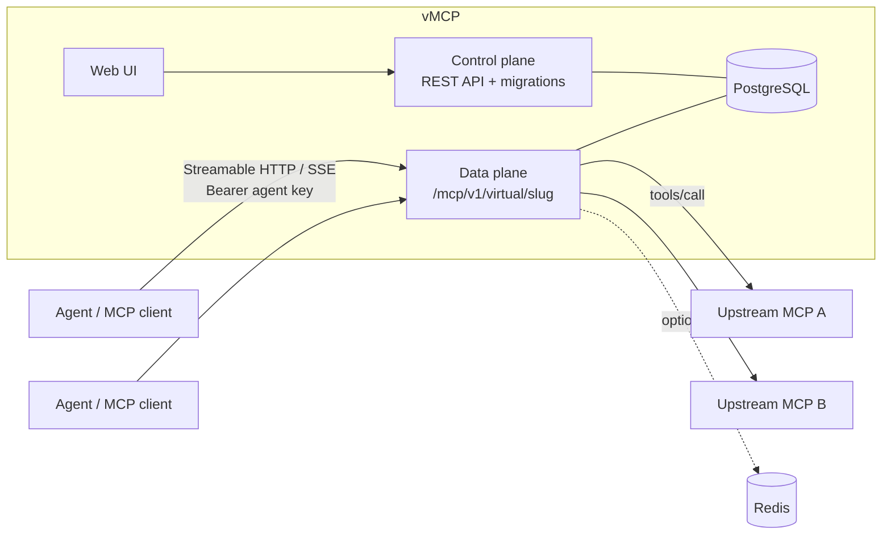

<div align="center">

# vMCP

**An open-source gateway for the Model Context Protocol.**
Register upstream MCP servers once, then compose their tools into *virtual MCP servers*:
one endpoint per agent or team, each exposing exactly the tools it should see.

[](https://github.com/bishoku/vmcp/actions/workflows/ci.yml)
[](LICENSE)

</div>

---

## Why vMCP?

Giving every agent a direct line to every MCP server does not scale: credentials are scattered, tool lists are
noisy, there is no audit trail, and one flaky server can stall everything. vMCP sits in between.

| You want to… | vMCP gives you |
|---|---|
| Expose only some tools to an agent | **Virtual servers**: pick tools from any upstream, reorder them, rename them, rewrite their descriptions |
| Stop leaking upstream credentials | Upstream headers & OAuth secrets are **encrypted at rest** (AES-256-GCM) and write-only; agents hold revocable keys or IdP tokens |
| Authenticate agents with your IdP | **OAuth for agents**: verify asymmetric JWTs, map claims to virtual servers with flexible **identity bindings** |
| Connect to OAuth-secured upstreams | **Upstream OAuth**: gateway fetches and caches tokens via **OAuth 2.0 client_credentials**, retrying on 401 |
| Keep sensitive data away from models | **PII masking** (IBAN, card, TCKN, SSN, email, phone, custom regex) on results and, optionally, arguments |
| Know who called what | **Audit log** of every call: agent, tool, upstream, status, duration, redactions |
| Restrict risky tools | **Tool policies**: allow / deny / read-only per tool, enforced from upstream `readOnlyHint` |
| Survive upstream failures | **Circuit breaker, retries for idempotent tools, failover URLs, health checks** |
| Scale out | Run N data-plane nodes on **PostgreSQL only**; Redis is optional and only for global rate limits |
| Reach internal servers | Per-upstream **custom CA / self-signed certs / mTLS** (verification is never disabled) |
| Manage it your way | Everything is available through a **REST API** (OpenAPI 3.1) *and* the web UI, plus declarative export/apply for GitOps |

## Architecture



- **Control plane** (`core/cmd/control-plane`): the configuration API ([`api/openapi.yaml`](api/openapi.yaml)); runs migrations.
- **Data plane** (`core/cmd/data-plane`): serves `/mcp/v1/virtual/{slug}` and proxies to upstreams. Stateless apart from
  PostgreSQL, so you can run several. Configuration changes arrive through `LISTEN/NOTIFY`, with no restart.
- **Web UI** (`web/`): React + Vite + Tailwind.
- **PostgreSQL**: the single source of truth (config, sessions, audit, health).

Scope today: **tools only** (no resources/prompts), upstream transports **Streamable HTTP and legacy HTTP+SSE**
(no stdio), single tenant (`default`).

## Quick start

Requires Docker.

```sh
git clone https://github.com/bishoku/vmcp.git && cd vmcp
docker compose -f deploy/docker-compose.yml up -d --build
```

| Service | URL |
|---|---|
| Web UI | http://localhost:3000 (admin token `dev-admin-token`) |
| Control plane API | http://localhost:8081/api/v1 |
| Data plane | http://localhost:8080/mcp/v1/virtual/{slug} |

> [!WARNING]
> The compose file ships **development-only** values for `VMCP_ADMIN_TOKEN` and `VMCP_MASTER_KEY`.
> Generate your own (`openssl rand -base64 32` for the key) before exposing anything. See
> [docs/Security.md](docs/Security.md).

Internal and loopback MCP servers now require an explicit `VMCP_EGRESS_ALLOW_CIDRS` grant on both services. Before using the host fixture below, authorize the actual IP/subnet that `host.docker.internal` resolves to inside your containers and recreate both services. See [network policy and development setup](docs/MCP_NETWORK_SECURITY.md) for instructions. Public upstreams remain available by default; an exact host allowlist can restrict them further.

### Five-minute tour

Start the bundled fixture MCP server, register it, and expose one tool under a new name:

```sh
(cd core && go run ./cmd/fixture-mcp -token up-secret) &       # http://localhost:9100/mcp

A="Authorization: Bearer dev-admin-token"; B=http://localhost:8081/api/v1
curl -X PUT -H "$A" -H 'Content-Type: application/json' $B/upstreams/fx -d '{
  "name":"Fixture","url":"http://host.docker.internal:9100/mcp",
  "headers":{"Authorization":"Bearer up-secret"}}'
curl -X POST -H "$A" $B/upstreams/fx/refresh-tools
curl -X PUT -H "$A" -H 'Content-Type: application/json' $B/virtual-servers/demo -d '{
  "name":"Demo","authRequired":false,
  "tools":[{"upstream":"fx","tool":"add","alias":"sum","description":"Add two numbers"}]}'
```

Point any MCP client at `http://localhost:8080/mcp/v1/virtual/demo`. To require authentication, leave
`authRequired` at its default (`true`) and create an agent key:

```sh
curl -X POST -H "$A" -H 'Content-Type: application/json' $B/agent-keys -d '{
  "slug":"my-agent","virtualServers":["demo"],"ipAllowlist":["10.0.0.0/8"]}'   # the key is shown once
# then send  Authorization: Bearer vmcp_...  to the data plane
```

## Documentation

The full documentation lives in [`docs/`](docs/Home.md) (published as the GitHub Wiki):

| | |
|---|---|
| [Getting started](docs/Getting-Started.md) | [Architecture](docs/Architecture.md) |
| [Configuration reference](docs/Configuration.md) | [Deployment](docs/Deployment.md) |
| [Upstreams](docs/Upstreams.md) | [Upstream TLS](docs/Upstream-TLS.md) & [OAuth](docs/Upstream-OAuth.md) |
| [Virtual servers](docs/Virtual-Servers.md) | [Tool policies](docs/Tool-Policies.md) |
| [Agent keys & auth](docs/Agent-Keys-and-Authentication.md) | [OAuth for agents](docs/OAuth-for-Agents.md) |
| [SSO & roles](docs/SSO-and-RBAC.md) | [PII masking](docs/PII-Masking.md) |
| [Audit log](docs/Audit-Log.md) | [Resilience & high availability](docs/Resilience-and-HA.md) |
| [Rate limits](docs/Rate-Limits.md) | [REST API & GitOps](docs/REST-API.md) |
| [Security](docs/Security.md) | [Development](docs/Development.md) |
| [FAQ & troubleshooting](docs/FAQ.md) | [Getting started](docs/Getting-Started.md) |

## Repository layout

```
api/openapi.yaml   REST contract (source of truth for the API)
core/              Go module github.com/bishoku/vmcp/core (control plane, data plane, fixture server)
web/               React UI
deploy/            Docker Compose (Postgres, control plane, data plane, web; optional Redis profile)
docs/              Wiki pages
```

## Status

MCP protocol baseline: **2025-06-18**. March support is no longer advertised. See the [protocol contract and upgrade notes](docs/MCP_PROTOCOL_CONTRACT.md) for transport compatibility and session migration behavior.

vMCP is young. The feature set above is implemented and covered by integration tests (PostgreSQL-backed, including
multi-node and TLS scenarios), but expect rough edges, and APIs may still change before a 1.0 release. Known gaps are
listed in the [FAQ](docs/FAQ.md#known-limitations). Not built (yet): Prometheus/OpenTelemetry metrics, Helm chart,
stdio upstreams, resources/prompts, multi-tenancy.

## Contributing

Issues and pull requests are welcome. Read [CONTRIBUTING.md](CONTRIBUTING.md) first; report vulnerabilities privately as
described in [SECURITY.md](SECURITY.md). Participation is governed by the [Code of Conduct](CODE_OF_CONDUCT.md).

## License

[Apache-2.0](LICENSE). Copyright 2026 Barış Oku.
