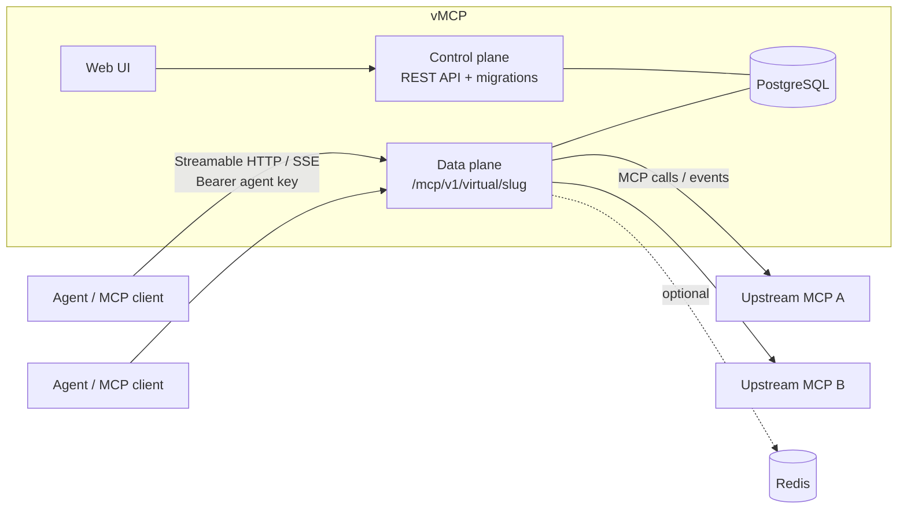

<div align="center">

# vMCP

**An open-source gateway for the Model Context Protocol.**
Register upstream MCP servers once, then curate their tools, resources and prompts into *virtual MCP servers*:
one endpoint per agent or team, each exposing the capabilities you select.

[](https://github.com/bishoku/vmcp/actions/workflows/ci.yml)
[](LICENSE)

</div>

---

## Why vMCP?

Giving every agent a direct line to every MCP server does not scale: credentials are scattered, tool lists are
noisy, there is no audit trail, and one flaky server can stall everything. vMCP sits in between.

| You want to… | vMCP gives you |
|---|---|
| Curate what an agent can access | **Virtual servers**: select tools, resources, URI templates and prompts; alias tools/resources/prompts and override descriptions |
| Connect interactive MCP hosts | **Bidirectional SSE**: progress, cancellation, replay, subscriptions and opt-in sampling, roots and form elicitation |
| Stop leaking upstream credentials | Upstream headers & OAuth secrets are **encrypted at rest** (AES-256-GCM) and write-only; agents hold revocable keys or IdP tokens |
| Authenticate agents with your IdP | **OAuth for agents**: verify asymmetric JWTs, map claims to virtual servers with flexible **identity bindings** |
| Connect to OAuth-secured upstreams | **Upstream OAuth**: gateway fetches and caches tokens via **OAuth 2.0 client_credentials**, retrying on 401 |
| Keep sensitive data away from models | **PII masking** (IBAN, card, TCKN, SSN, email, phone, custom regex) on results and, optionally, arguments |
| Trace protected operations | **Strict audit admission/outcome**, administrative change records, incomplete-operation queries and durable HTTPS SIEM delivery |
| Restrict risky tools | **Tool policies**: allow / deny / read-only per tool, enforced from upstream `readOnlyHint` |
| Survive upstream failures | **Circuit breaker, retries for idempotent tools, failover URLs, health checks** |
| Scale out | Run N data-plane nodes on **PostgreSQL only**; Redis is optional and only for global rate limits |
| Reach internal servers | Per-upstream **custom CA / self-signed certs / mTLS** (verification is never disabled) |
| Manage it your way | Everything is available through a **REST API** (OpenAPI 3.1) *and* the web UI, plus declarative export/apply for GitOps |

## Architecture



- **Control plane** (`core/cmd/control-plane`): the configuration API ([`api/openapi.yaml`](api/openapi.yaml)); runs migrations.
- **Data plane** (`core/cmd/data-plane`): serves `/mcp/v1/virtual/{slug}` and proxies to upstreams. Shared session, operation and replay records in
  PostgreSQL let you run several nodes; physical upstream connections and caches remain local. Configuration
  changes converge through `LISTEN/NOTIFY` and polling, with bounded authorization freshness.
- **Web UI** (`web/`): React + Vite + Tailwind.
- **PostgreSQL**: the single source of truth (config, sessions, audit, health).

Scope today: curated **tools, resources, templates and prompts**; negotiated client
features; upstream **Streamable HTTP, legacy HTTP+SSE and isolated stdio workers**.
Hosted tenants use dedicated plane/database deployments and exact-host routing.
See [catalog limits](docs/MCP_CATALOGS.md), [client features](docs/MCP_CLIENT_FEATURES.md)
and [tenant/worker boundaries](docs/TENANT_AND_STDIO_OPERATIONS.md).

## Quick start

Requires Docker. For a ready-to-run environment with **Keycloak, Redis, two data planes, a load balancer and three MCP servers**, use the [manual testing stack](benchmark/README.md). It starts with an empty configuration so you can register upstreams and compose virtual servers from the UI.

The smaller quick start below runs the core services.

```sh
git clone https://github.com/bishoku/vmcp.git && cd vmcp
docker compose -f deploy/docker-compose.yml up -d --build
```

| Service | URL |
|---|---|
| Web UI | http://localhost:3000 (admin token `dev-admin-token`) |
| Control plane API | http://localhost:8081/api/v1 |
| Data plane | http://localhost:8080/mcp/v1/virtual/{slug} |

> [!WARNING]
> The compose file ships **development-only** values for `VMCP_ADMIN_TOKEN` and `VMCP_MASTER_KEY`.
> Generate your own (`openssl rand -base64 32` for the key) before exposing anything. See
> [docs/Security.md](docs/Security.md).

Internal and loopback MCP servers now require an explicit `VMCP_EGRESS_ALLOW_CIDRS` grant on both services. Before using the host fixture below, authorize the actual IP/subnet that `host.docker.internal` resolves to inside your containers and recreate both services. See [network policy and development setup](docs/MCP_NETWORK_SECURITY.md) for instructions. Public upstreams remain available by default; an exact host allowlist can restrict them further.

### Five-minute tour

Start the bundled fixture MCP server, register it, and expose one tool under a new name:

```sh
(cd core && go run ./cmd/fixture-mcp -token up-secret) &       # http://localhost:9100/mcp

A="Authorization: Bearer dev-admin-token"; B=http://localhost:8081/api/v1
curl -X PUT -H "$A" -H 'Content-Type: application/json' $B/upstreams/fx -d '{
  "name":"Fixture","url":"http://host.docker.internal:9100/mcp",
  "headers":{"Authorization":"Bearer up-secret"}}'
curl -X POST -H "$A" $B/upstreams/fx/refresh-tools
curl -X PUT -H "$A" -H 'Content-Type: application/json' $B/virtual-servers/demo -d '{
  "name":"Demo","authRequired":false,
  "tools":[{"upstream":"fx","tool":"add","alias":"sum","description":"Add two numbers"}]}'
```

Point any MCP client at `http://localhost:8080/mcp/v1/virtual/demo`. To require authentication, leave
`authRequired` at its default (`true`) and create an agent key:

```sh
curl -X POST -H "$A" -H 'Content-Type: application/json' $B/agent-keys -d '{
  "slug":"my-agent","virtualServers":["demo"],"ipAllowlist":["10.0.0.0/8"]}'   # the key is shown once
# then send  Authorization: Bearer vmcp_...  to the data plane
```

## Documentation

The full documentation lives in [`docs/`](docs/Home.md) (published as the GitHub Wiki):

| | |
|---|---|
| [Getting started](docs/Getting-Started.md) | [Architecture](docs/Architecture.md) |
| [Configuration reference](docs/Configuration.md) | [Deployment](docs/Deployment.md) |
| [Upstreams](docs/Upstreams.md) | [Upstream TLS](docs/Upstream-TLS.md) & [OAuth](docs/Upstream-OAuth.md) |
| [Virtual servers](docs/Virtual-Servers.md) | [Tool policies](docs/Tool-Policies.md) |
| [Agent keys & auth](docs/Agent-Keys-and-Authentication.md) | [OAuth for agents](docs/OAuth-for-Agents.md) |
| [SSO & roles](docs/SSO-and-RBAC.md) | [PII masking](docs/PII-Masking.md) |
| [Audit log](docs/Audit-Log.md) | [Resilience & high availability](docs/Resilience-and-HA.md) |
| [Rate limits](docs/Rate-Limits.md) | [REST API & GitOps](docs/REST-API.md) |
| [Security](docs/Security.md) | [Development](docs/Development.md) |
| [Catalogs & prompts](docs/MCP_CATALOGS.md) | [Client features](docs/MCP_CLIENT_FEATURES.md) |
| [Protocol & SSE delivery](docs/MCP_PROTOCOL_CONTRACT.md) | [Audit operations](docs/AUDIT_OPERATIONS.md) |
| [Manual testing stack](benchmark/README.md) | [Production deployment](docs/PRODUCTION_DEPLOYMENT.md) |
| [FAQ & troubleshooting](docs/FAQ.md) | [Tenants & stdio](docs/TENANT_AND_STDIO_OPERATIONS.md) |

## Repository layout

```
api/openapi.yaml   REST contract (source of truth for the API)
core/              Go module github.com/bishoku/vmcp/core (control plane, data plane, fixture server)
web/               React UI
deploy/            Docker Compose (Postgres, control plane, data plane, web; optional Redis profile)
benchmark/         Local multi-node manual testing stack, Keycloak realm, synthetic MCP servers and clients
docs/              Wiki pages
```

## Status

MCP protocol baseline: **2025-06-18**. March support is no longer advertised. See the [protocol contract and upgrade notes](docs/MCP_PROTOCOL_CONTRACT.md) for transport compatibility and session migration behavior.

vMCP remains **Beta / development**, with APIs subject to change. Automated regression
coverage includes PostgreSQL/Redis, multi-node authorization and replay, TLS,
MCP SDK interoperability, browser workflows and isolated-container checks.
Production acceptance still requires deployment-specific load, HA promotion,
backup/restore, sink access-control and incident-response evidence described in
[the deployment guide](docs/PRODUCTION_DEPLOYMENT.md). No production SLA or
compliance certification is claimed.

| Capability | Implemented scope and limits |
|---|---|
| MCP catalog | Tools, resources/templates, prompts, selected completion and durable subscription grants; [contract](docs/MCP_CATALOGS.md) |
| Bidirectional delivery | Shared PostgreSQL operation fencing, SSE replay, progress/cancellation and mapped client replies; [delivery](docs/MCP_DELIVERY.md) |
| Client features | Explicit sampling, roots and form elicitation permissions/budgets; logging and rich tool metadata; [limits](docs/MCP_CLIENT_FEATURES.md) |
| Security | Versioned context-bound encryption, restartable rotation, shared SSO revocation, exact-JWT denylist and privacy/approval policies; [operations](docs/SECURITY_OPERATIONS.md) |
| Audit | Strict admission/outcome, bounded retention, legal holds and durable HTTPS SIEM delivery; [evidence responsibilities](docs/AUDIT_OPERATIONS.md) |
| Operations | Prometheus metrics, optional OTLP tracing, Helm and integration/SDK/browser CI checks; [deployment](docs/PRODUCTION_DEPLOYMENT.md) |
| Stdio | Separate mTLS worker with immutable allowlists, resource/filesystem/network isolation and operator secret injection; fixed owner endpoint |
| Tenants | Dedicated databases, processes, credentials, keys and host routing; shared-schema tenant switching is excluded |


## Roadmap to production readiness

The June MCP feature families above are implemented within their documented limits.
The next milestone is reliable, secure operation under real deployment failures.
These items remain open; their order reflects production risk, not release dates.

- [ ] **Worker containment and recovery:** prevent Docker daemon payload logging, reconcile orphaned containers after crashes, verify cleanup failures and storage quotas, and share protocol validation with the gateway. Keep fixed worker ownership and avoid unsafe replay.
- [ ] **Least-privilege audit identities:** make exporter startup and audit inserts work with the supplied restricted roles after tenant identity migration; test allowed and forbidden SQL operations with real runtime logins.
- [ ] **Policy and audit parity:** record catalog denial decisions, bind approval to executed/returned content, clarify prompt-content trust, and align background subscription revocation/fallback behavior.
- [ ] **Sustained audit operations:** separately privileged retention runner, large-operation handling, exporter lag/dead-letter metrics and alerts, authenticated SIEM sinks, and representative purge/WAL measurements.
- [ ] **Repeatable correctness gates:** diagnose intermittent mixed-workload failures, validate fresh update/export/apply API examples, broaden browser GitOps/SSO coverage, and require exact-commit tests/scans before release artifacts.
- [ ] **Deployment evidence:** sustained multi-node load with p95/p99 and database budgets; rolling restart, PostgreSQL promotion, LISTEN loss and Redis outage drills; restore configuration, encrypted secrets, audit receipts and legal holds with measured RPO/RTO.
- [ ] **Tenant and routing assurance:** canonical target-origin checks, streaming-aware proxy deadlines and complete deployed cross-tenant credential/session/audit tests. Dedicated databases/processes remain the supported model; shared-schema tenant switching is a separate future design.
- [ ] **Management and supply-chain polish:** explicit per-object description-drift acknowledgment, complete service image scanning, artifact provenance/SBOM/signing and documented support/security response commitments.

Production acceptance also needs organization-owned secret custody, access reviews,
retention/privacy decisions and an independently administered immutable audit sink
where required. Code changes alone do not establish SOC 2, ISO 27001 or GDPR compliance.
See [production deployment](docs/PRODUCTION_DEPLOYMENT.md),
[audit operations](docs/AUDIT_OPERATIONS.md) and [security operations](docs/SECURITY_OPERATIONS.md).


## Contributing

Issues and pull requests are welcome. Read [CONTRIBUTING.md](CONTRIBUTING.md) first; report vulnerabilities privately as
described in [SECURITY.md](SECURITY.md). Participation is governed by the [Code of Conduct](CODE_OF_CONDUCT.md).

## License

[Apache-2.0](LICENSE). Copyright 2026 Barış Oku.
