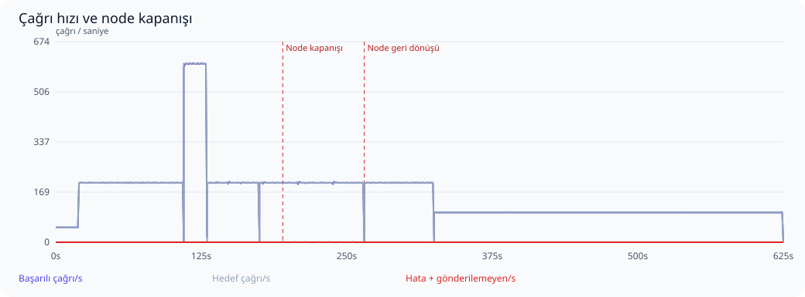
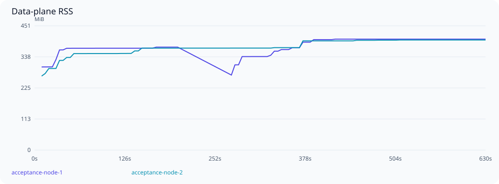

# Ölçek ve dayanıklılık kabul testi

Başlangıç: 2026-10-16T14:21:03Z. Sonuç: **GEÇTİ**.

Envanter: 300 upstream, 300 virtual server, 90,000 tool tanımı/seçimi, 30,000 resource tanımı/seçimi; 600 kalıcı session, 64 yapılandırılmış agent key.

İki ayrı gerçek data-plane süreci; her birinde GOMAXPROCS=2, 768 MiB Go yumuşak bellek limiti ve 64 bağlantılık DB pool. Ayrı PostgreSQL 17 konteyneri 2 CPU / 2 GiB; ayrı Redis konteyneri 0,5 CPU / 256 MiB. Ana uygulama ortamına dokunulmadı.

300 mantıksal upstream adresi 16 sentetik HTTP fixture dinleyicisine dağıtılır. Tool yanıtı 5 ms geciktirilir. Her yanıtta doğru upstream rotası, tool adı, çağrı nonce’u ve PII maskesi doğrulanır. Bu gerçek upstream servislerinin kapasite veya ağ gecikmesi testi değildir.

Test proxy’si round-robin dağıtır, arızalı node için 10 saniyelik pasif bekleme uygular ve POST isteğini başka node’a tekrar göndermez. Üretim ingress’i/nginx bu koşunun parçası değildir. Node kaybı SIGKILL ile yapılır; PostgreSQL HA/failover kapsam dışıdır.

## Aşamalar

| Aşama | Hedef çağrı/s | Başarılı çağrı/s | Başarı % | p95 ms | p99 ms | Hata | Gönderilemeyen | Eşik |
|---|---:|---:|---:|---:|---:|---:|---:|---|
| Isınma | 50 | 50.0 | 100.000 | 17.6 | 19.0 | 0 | 0 | Geçti |
| Sabit yük | 200 | 200.0 | 100.000 | 17.8 | 20.4 | 0 | 0 | Geçti |
| Ani yük artışı | 600 | 599.2 | 100.000 | 26.7 | 33.4 | 0 | 0 | Geçti |
| Yük sonrası toparlanma | 200 | 200.0 | 100.000 | 17.7 | 19.9 | 0 | 0 | Geçti |
| Node kaybı | 200 | 199.9 | 99.956 | 18.0 | 20.2 | 8 | 0 | Geçti |
| Node geri dönüşü | 200 | 200.0 | 100.000 | 18.1 | 21.3 | 0 | 0 | Geçti |
| Süreklilik | 100 | 100.0 | 100.000 | 18.6 | 20.1 | 0 | 0 | Geçti |

Yüzdelikler yalnızca başarılı çağrıların servis gecikmesidir; hatalar ayrıca sayılır. Başarı oranı gönderilen isteklere göre, çağrı/s ise kuyruk boşaltma dahil gerçek aşama süresine göre hesaplanır. Gönderilemeyen istekler de hedefin karşılanması değerlendirmesine dahildir. İstemci retry yapmaz.



## Tutarlılık ve güvenlik

- Başarılı istemci çağrısı: **99992**.
- Eşleşen kalıcı audit admission: **99992**.
- Eşleşen başarılı audit outcome: **99992**.
- Çift upstream çalıştırma: **0**.
- Outcome’u olmayan admission: **1**.
- Hatalı istemci çağrısıyla açıklanamayan eksik outcome: **0**.
- Çağrı alan farklı upstream: **300**.
- Çağrı alan farklı virtual server: **300**.
- Çağrı alan farklı virtual tool: **71051**.
- Çağrı yapan farklı agent key: **64**.

Node kapanışında kalıcı admission’dan sonra outcome yazılamamış olabilir. Bunlar yalnızca hatalı istemci isteğiyle eşleşiyorsa açıklanmış belirsiz işlemler olarak tutulur; başarılı sayılmaz veya yeniden çalıştırılmaz. Başarılı her istemci yanıtı için admission ve başarılı outcome ayrı ayrı doğrulanır.

- `cross_node_session_and_paginated_masked_metadata`: geçti.
- `invalid_keys_rejected_on_both_nodes`: geçti.
- `key_revocation_propagated_and_rejected_on_both_nodes`: geçti.
- `session_termination_authoritative_on_both_nodes`: geçti.

## Kaynak kullanımı

| Node | En yüksek RSS MiB | Medyan OS CPU % | Örneklenen DB pool tepe kullanımı | Pool edinim iptali (gözlenen en yüksek sayaç) | Soak RSS değişimi % |
|---|---:|---:|---:|---:|---:|
| acceptance-node-1 | 402.2 | 12.2 | 6/64 | 0 | 2.8 |
| acceptance-node-2 | 399.1 | 12.7 | 7/64 | 0 | 0.8 |



PostgreSQL: örneklenen bağlantı tepe sayısı **61 / 200**, deadlock **0**, lock bekleyen oturum tepe sayısı **0**. Test veritabanı boyutu ilk/son örnekte **128.5 / 347.0 MiB**. Audit ve dayanıklı delivery kayıtları bu büyümeye dahildir.


RSS yaklaşık beş saniyede bir örneklenir; Go heap ile aynı değildir. CPU yüzdesi işletim sisteminin süreç için raporladığı değerdir; birden çok çekirdekte %100’ü aşabilir. Node yeniden başladığında sayaçlar sıfırlanır. Bu profilde rate-limit değerleri sınırsızdır; Redis limiter maliyeti ölçülmemiştir. Kısa soak süresi uzun dönemli bellek sızıntısının olmadığını kanıtlamaz.

Kaynak örneği: 125. Konteyner kaynağı örneği: 248. PostgreSQL connection, lock wait, deadlock, transaction ve disk boyutu örnekleri ham raporda bulunur. Metrik etiket taşmaları beklenen cardinality sınırıdır; tüm tool’lara ayrı seri ayrıldığı anlamına gelmez.

## Eşikler ve sınırlamalar

- Sabit yük: hedefin en az %95’i, gönderilenlerde en az %99,9 başarı; p95 ≤250 ms, p99 ≤1000 ms.
- Yük artışı: hedefin en az %80’i, en az %80 başarı; p99 <10 saniye ve bozuk sonuç olmaması.
- Node geçişi: aşamada en az %99 başarı; 10 saniyelik geçişten sonra hata ≤%0,1, p99 ≤1000 ms. Pasif sağlık kontrolü isteğinin hatası da sayılır.
- Node RSS ≤1,5 GiB; soak ilk/son üçte birlik medyanları arasında artış ≤%20.
- Yerel, tek fiziksel makine ve tek PostgreSQL örneği. Üretim ağları, JWT/IdP yükü, kontrol düzlemi discovery/config churn, uzun çalışan gerçek araçlar ve veritabanı HA dahil değildir.


## Değerlendirme

Bu yerel profil, önceden belirlenen kabul eşiklerini karşıladı. Toplam 100,000 planlanan isteğin 99,992 adedi doğru yanıt ve kalıcı audit eşleşmesiyle tamamlandı. Tüm 300 virtual server ve 300 upstream gerçek çağrı aldı; 71,051 farklı virtual tool çalıştırıldı.

Mevcut yapı bu profil için yeterli kapasite payı gösteriyor; ikinci optimizasyon paketini zorunlu kılan bir darboğaz gözlenmedi. Bu sonuç mikro tuning yerine kod basitliğini korumayı destekliyor. İlk mikrobenchmarkdan farklı olarak bu koşu tam üretim data-plane’inin dayanıklı MCP delivery/SSE yolunu da çalıştırır; bu iki koşunun gecikmeleri doğrudan karşılaştırılmamalı. Üretim boyutlandırması için farklı gerçek upstream gecikmeleri, JWT/rate-limit politikaları ve ingress ayrıca doğrulanmalı.

Node kapanışından sonra 1 çağrının audit outcome’u yoktur. Bu kayıt hatalı istemci isteğiyle eşleşir; yürütme sonucu belirsizdir. Başarılı sayılmadı ve otomatik tekrar yürütülmedi. İş açısından yan etkili gerçek tool kullanımlarında bu belirsizlik ayrıca uzlaştırılmalıdır.

## Tekrarlanabilirlik

Kaynak HEAD: `c12a4e577558ad8159be902dc34d9f081013ddee`; çalışma ağacındaki değişiklikleri içeren gerçek binary SHA-256: `e0f0677acaea9c3405ecb6c5c6d44c83b224fddbb2cb2341d0af568a676513e8`.
go1.27.2, darwin/arm64. Ham örnekler ve sayaçlar: [report.json](report.json).

```sh
./scripts/acceptance-core.sh
```
