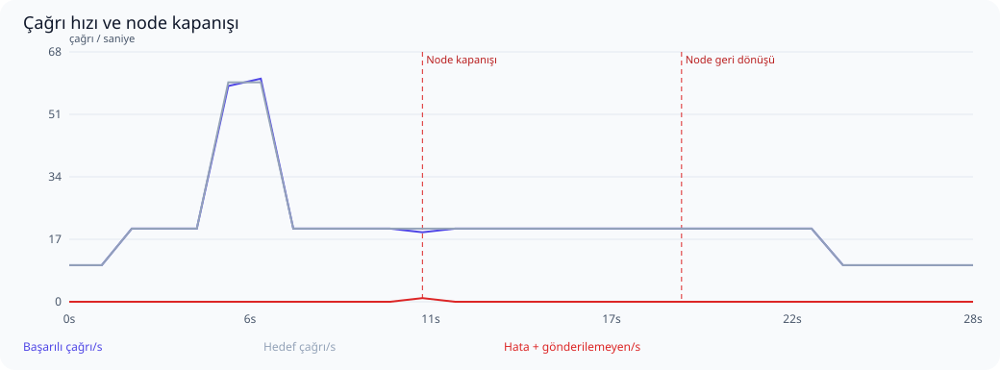
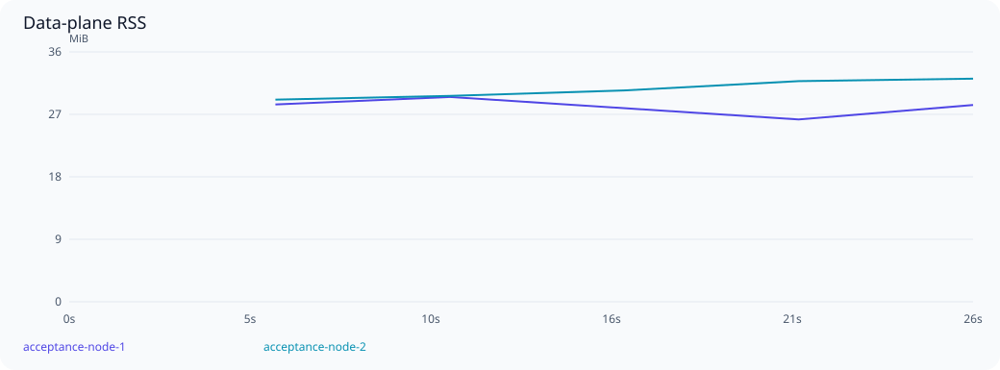

# Ölçek ve dayanıklılık kabul testi

Başlangıç: 2026-10-16T14:19:18Z. Sonuç: **GEÇTİ**.

Bu kısa koşu yalnızca test düzeneğinin fonksiyonel doğrulamasıdır; kapasite kabulü değildir.

Envanter: 8 upstream, 8 virtual server, 160 tool tanımı/seçimi, 80 resource tanımı/seçimi; 16 kalıcı session, 64 yapılandırılmış agent key.

İki ayrı gerçek data-plane süreci; her birinde GOMAXPROCS=2, 768 MiB Go yumuşak bellek limiti ve 64 bağlantılık DB pool. Ayrı PostgreSQL 17 konteyneri 2 CPU / 2 GiB; ayrı Redis konteyneri 0,5 CPU / 256 MiB. Ana uygulama ortamına dokunulmadı.

8 mantıksal upstream adresi 16 sentetik HTTP fixture dinleyicisine dağıtılır. Tool yanıtı 5 ms geciktirilir. Her yanıtta doğru upstream rotası, tool adı, çağrı nonce’u ve PII maskesi doğrulanır. Bu gerçek upstream servislerinin kapasite veya ağ gecikmesi testi değildir.

Test proxy’si round-robin dağıtır, arızalı node için 10 saniyelik pasif bekleme uygular ve POST isteğini başka node’a tekrar göndermez. Üretim ingress’i/nginx bu koşunun parçası değildir. Node kaybı SIGKILL ile yapılır; PostgreSQL HA/failover kapsam dışıdır.

## Aşamalar

| Aşama | Hedef çağrı/s | Başarılı çağrı/s | Başarı % | p95 ms | p99 ms | Hata | Gönderilemeyen | Eşik |
|---|---:|---:|---:|---:|---:|---:|---:|---|
| Isınma | 10 | 10.4 | 100.000 | 31.2 | 34.8 | 0 | 0 | Geçti |
| Sabit yük | 20 | 20.2 | 100.000 | 23.2 | 24.9 | 0 | 0 | Geçti |
| Ani yük artışı | 60 | 60.0 | 100.000 | 17.5 | 19.2 | 0 | 0 | Geçti |
| Yük sonrası toparlanma | 20 | 20.3 | 100.000 | 22.5 | 25.5 | 0 | 0 | Geçti |
| Node kaybı | 20 | 20.0 | 99.500 | 24.2 | 26.9 | 1 | 0 | Geçti |
| Node geri dönüşü | 20 | 20.1 | 100.000 | 24.5 | 30.7 | 0 | 0 | Geçti |
| Süreklilik | 10 | 10.2 | 100.000 | 26.2 | 29.4 | 0 | 0 | Geçti |

Yüzdelikler yalnızca başarılı çağrıların servis gecikmesidir; hatalar ayrıca sayılır. Başarı oranı gönderilen isteklere göre, çağrı/s ise kuyruk boşaltma dahil gerçek aşama süresine göre hesaplanır. Gönderilemeyen istekler de hedefin karşılanması değerlendirmesine dahildir. İstemci retry yapmaz.



## Tutarlılık ve güvenlik

- Başarılı istemci çağrısı: **589**.
- Eşleşen kalıcı audit admission: **589**.
- Eşleşen başarılı audit outcome: **589**.
- Çift upstream çalıştırma: **0**.
- Outcome’u olmayan admission: **0**.
- Hatalı istemci çağrısıyla açıklanamayan eksik outcome: **0**.
- Çağrı alan farklı upstream: **8**.
- Çağrı alan farklı virtual server: **8**.
- Çağrı alan farklı virtual tool: **160**.
- Çağrı yapan farklı agent key: **16**.

Node kapanışında kalıcı admission’dan sonra outcome yazılamamış olabilir. Bunlar yalnızca hatalı istemci isteğiyle eşleşiyorsa açıklanmış belirsiz işlemler olarak tutulur; başarılı sayılmaz veya yeniden çalıştırılmaz. Başarılı her istemci yanıtı için admission ve başarılı outcome ayrı ayrı doğrulanır.

- `cross_node_session_and_paginated_masked_metadata`: geçti.
- `invalid_keys_rejected_on_both_nodes`: geçti.
- `key_revocation_propagated_and_rejected_on_both_nodes`: geçti.
- `session_termination_authoritative_on_both_nodes`: geçti.

## Kaynak kullanımı

| Node | En yüksek RSS MiB | Medyan OS CPU % | En yüksek DB pool kullanımı | Pool edinim iptali (gözlenen en yüksek sayaç) | Soak RSS değişimi % |
|---|---:|---:|---:|---:|---:|
| acceptance-node-1 | 29.9 | 2.5 | 1/64 | 0 | örnek yetersiz |
| acceptance-node-2 | 32.6 | 5.0 | 1/64 | 0 | örnek yetersiz |



RSS yaklaşık beş saniyede bir örneklenir; Go heap ile aynı değildir. CPU yüzdesi işletim sisteminin süreç için raporladığı değerdir; birden çok çekirdekte %100’ü aşabilir. Node yeniden başladığında sayaçlar sıfırlanır. Kısa soak süresi uzun dönemli bellek sızıntısının olmadığını kanıtlamaz.

Kaynak örneği: 5. Konteyner kaynağı örneği: 10. PostgreSQL connection, lock wait, deadlock, transaction ve disk boyutu örnekleri ham raporda bulunur. Metrik etiket taşmaları beklenen cardinality sınırıdır; tüm tool’lara ayrı seri ayrıldığı anlamına gelmez.

## Eşikler ve sınırlamalar

- Sabit yük: hedefin en az %95’i, gönderilenlerde en az %99,9 başarı; p95 ≤250 ms, p99 ≤1000 ms.
- Yük artışı: hedefin en az %80’i, en az %80 başarı; p99 <10 saniye ve bozuk sonuç olmaması.
- Node geçişi: aşamada en az %99 başarı; 10 saniyelik geçişten sonra hata ≤%0,1, p99 ≤1000 ms. Pasif sağlık kontrolü isteğinin hatası da sayılır.
- Node RSS ≤1,5 GiB; soak ilk/son üçte birlik medyanları arasında artış ≤%20.
- Yerel, tek fiziksel makine ve tek PostgreSQL örneği. Üretim ağları, JWT/IdP yükü, kontrol düzlemi discovery/config churn, uzun çalışan gerçek araçlar ve veritabanı HA dahil değildir.

## Tekrarlanabilirlik

Kaynak HEAD: `c12a4e577558ad8159be902dc34d9f081013ddee`; çalışma ağacındaki değişiklikleri içeren gerçek binary SHA-256: `e0f0677acaea9c3405ecb6c5c6d44c83b224fddbb2cb2341d0af568a676513e8`.
go1.27.2, darwin/arm64. Ham örnekler ve sayaçlar: [report.json](report.json).

```sh
./scripts/acceptance-core.sh
```
