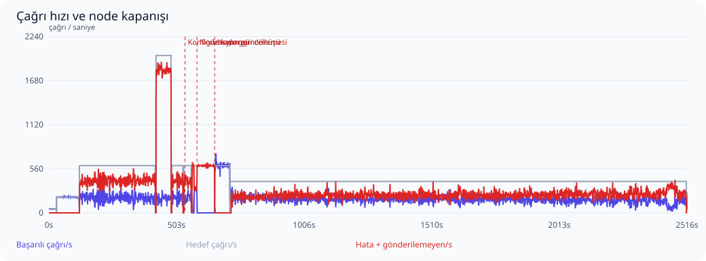
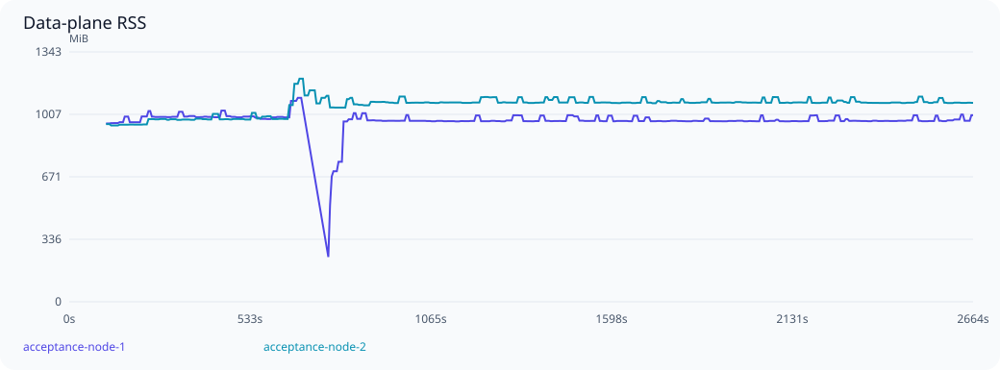

# MicroK8s üzerinde ölçek ve dayanıklılık testi

Başlangıç: 2026-10-23T16:30:41Z. Sonuç: **BULGU VAR / KABUL EŞİKLERİ KARŞILANMADI**.

Profil: **REST upstream**. Kaydedilmiş JSON operasyonları, request/response şema doğrulaması ve mevcut MCP istemci yolu kullanıldı.
Snapshot yayılımı **25560 ms gözlem penceresinde doğrulanamadı**.

Envanter: 300 upstream, 300 virtual server, 60,000 tool tanımı/seçimi, 0 resource tanımı/seçimi; 600 kalıcı session, 64 yapılandırılmış agent key.

MicroK8s üzerinde ayrı test namespace’i: iki data-plane podu ve bir control-plane podu. Data plane başına GOMAXPROCS=2, GOMEMLIMIT=768MiB, 64 bağlantılık pool; Kubernetes CPU limiti 4, bellek limiti 3GiB. PostgreSQL limiti 4 CPU / 4GiB, Redis 1 CPU / 512MiB. Envanter ve yük sürücüsü host üzerinde; PostgreSQL/Redis ve uygulama Kubernetes üzerinde. Mevcut vmcp-demo değiştirilmedi.

300 mantıksal upstream adresi 16 sentetik HTTP fixture dinleyicisine dağıtılır. Tool yanıtı 5 ms geciktirilir. Her yanıtta doğru upstream rotası, tool adı, çağrı nonce’u ve PII maskesi doğrulanır. Bu gerçek upstream servislerinin kapasite veya ağ gecikmesi testi değildir.

Test proxy’si round-robin dağıtır, arızalı node için 10 saniyelik pasif bekleme uygular ve POST isteğini başka node’a tekrar göndermez. Üretim ingress’i/nginx bu koşunun parçası değildir. Tek data-plane Deployment sıfır replikaya indirilip yeniden açılır. Bu fiziksel Kubernetes node arızası veya zorunlu SIGKILL değildir; PostgreSQL HA/failover kapsam dışıdır.

## Aşamalar

| Aşama | Hedef çağrı/s | Başarılı çağrı/s | Başarı % | p95 ms | p99 ms | Hata | Gönderilemeyen | Eşik |
|---|---:|---:|---:|---:|---:|---:|---:|---|
| Isınma | 50 | 49.9 | 100.000 | 69.1 | 98.5 | 0 | 0 | Geçti |
| baseline | 200 | 199.1 | 100.000 | 143.7 | 360.8 | 0 | 0 | Geçti |
| Sabit yük | 600 | 191.2 | 96.640 | 3280.5 | 3629.1 | 2008 | 120232 | Karşılanmadı |
| Ani yük artışı | 2000 | 184.0 | 94.608 | 5091.7 | 5521.0 | 649 | 107964 | Karşılanmadı |
| Yük sonrası toparlanma | 600 | 191.4 | 97.032 | 3312.9 | 3675.6 | 278 | 17633 | Karşılanmadı |
| config-refresh | 600 | 190.1 | 94.548 | 4542.4 | 4891.3 | 351 | 11562 | Karşılanmadı |
| Pod devreden çıkarma | 600 | 44.9 | 7.486 | 431.1 | 682.7 | 49955 | 3 | Karşılanmadı |
| Pod geri dönüşü | 600 | 597.1 | 99.997 | 631.4 | 842.1 | 1 | 59 | Geçti |
| Süreklilik | 400 | 172.1 | 93.886 | 5583.8 | 5981.1 | 20197 | 389676 | Karşılanmadı |

Yüzdelikler yalnızca başarılı çağrıların servis gecikmesidir; hatalar ayrıca sayılır. Başarı oranı gönderilen isteklere göre, çağrı/s ise kuyruk boşaltma dahil gerçek aşama süresine göre hesaplanır. Gönderilemeyen istekler de hedefin karşılanması değerlendirmesine dahildir. İstemci retry yapmaz.



## Tutarlılık ve güvenlik

- Başarılı istemci çağrısı: **453932**.
- Eşleşen kalıcı audit admission: **453932**.
- Eşleşen başarılı audit outcome: **453932**.
- Çift upstream çalıştırma: **0**.
- Outcome’u olmayan admission: **571**.
- Hatalı istemci çağrısıyla açıklanamayan eksik outcome: **0**.
- Çağrı alan farklı upstream: **300**.
- Çağrı alan farklı virtual server: **300**.
- Çağrı alan farklı virtual tool: **59998**.
- Çağrı yapan farklı agent key: **64**.

Node kapanışında kalıcı admission’dan sonra outcome yazılamamış olabilir. Bunlar yalnızca hatalı istemci isteğiyle eşleşiyorsa açıklanmış belirsiz işlemler olarak tutulur; başarılı sayılmaz veya yeniden çalıştırılmaz. Başarılı her istemci yanıtı için admission ve başarılı outcome ayrı ayrı doğrulanır.

- `configuration_refresh_under_rest_load`: karşılanmadı.
- `cross_node_session_and_paginated_masked_metadata`: geçti.
- `invalid_keys_rejected_on_both_nodes`: geçti.
- `key_revocation_propagated_and_rejected_on_both_nodes`: karşılanmadı.
- `session_termination_authoritative_on_both_nodes`: geçti.

## Kaynak kullanımı

| Node | En yüksek RSS MiB | Medyan OS CPU % | Örneklenen DB pool tepe kullanımı | Pool edinim iptali (gözlenen en yüksek sayaç) | Soak RSS değişimi % |
|---|---:|---:|---:|---:|---:|
| acceptance-node-1 | 1095.9 | 199.9 | 64/64 | 12633 | 0.0 |
| acceptance-node-2 | 1199.0 | 199.8 | 64/64 | 83368 | -0.1 |



PostgreSQL: örneklenen bağlantı tepe sayısı **143 / 200**, deadlock **0**, lock bekleyen oturum tepe sayısı **127**. Test veritabanı boyutu ilk/son örnekte **158.3 / 1365.2 MiB**. Audit ve dayanıklı delivery kayıtları bu büyümeye dahildir.


RSS yaklaşık beş saniyede bir örneklenir; Go heap ile aynı değildir. RSS kubelet container RSS değeridir. CPU, kubelet usageNanoCores değerinden hesaplanan yakın dönem kullanımdır; önceki native ps ortalamasıyla aynı ölçüm değildir ve birden çok çekirdekte %100’ü aşabilir. Node yeniden başladığında sayaçlar sıfırlanır. Bu profilde rate-limit değerleri sınırsızdır; Redis limiter maliyeti ölçülmemiştir. Bu süre uzun dönemli bellek sızıntısının olmadığını kanıtlamaz.

Kaynak örneği: 512. Konteyner kaynağı örneği: 1536. PostgreSQL connection, lock wait, deadlock, transaction ve disk boyutu örnekleri ham raporda bulunur. Metrik etiket taşmaları beklenen cardinality sınırıdır; tüm tool’lara ayrı seri ayrıldığı anlamına gelmez.

## Eşikler ve sınırlamalar

- Sabit yük: hedefin en az %95’i, gönderilenlerde en az %99,9 başarı; p95 ≤250 ms, p99 ≤1000 ms.
- Yük artışı: hedefin en az %80’i, en az %80 başarı; p99 <10 saniye ve bozuk sonuç olmaması.
- Node geçişi: aşamada en az %99 başarı; 10 saniyelik geçişten sonra hata ≤%0,1, p99 ≤1000 ms. Pasif sağlık kontrolü isteğinin hatası da sayılır.
- Node RSS ≤1,5 GiB; soak ilk/son üçte birlik medyanları arasında artış ≤%20.
- Yerel, tek fiziksel makine ve tek PostgreSQL örneği. Üretim ağları, JWT/IdP yükü, kontrol düzlemi discovery/config churn, uzun çalışan gerçek araçlar ve veritabanı HA dahil değildir.

## Kabul bulguları

- steady capacity/latency SLO failed
- spike capacity/latency SLO failed
- recovery capacity/latency SLO failed
- REST configuration refresh did not reach both nodes
- config-refresh capacity/latency SLO failed
- node-loss capacity/latency SLO failed
- soak capacity/latency SLO failed
- revoked key accepted or snapshot propagation timed out on acceptance-node-1
- revoked key accepted or snapshot propagation timed out on acceptance-node-2

## Tekrarlanabilirlik

Kaynak HEAD: `922c16eb3d6571fd11f65ff3add2fe1d0d4ad33d`; çalışma ağacındaki değişiklikleri içeren gerçek binary SHA-256: `9f7dbbb86394ce3b79db91268ccb443c063ea14e5e7fa4fb132082c82cc70f03`.
go1.27.3, linux/amd64. Ham örnekler ve sayaçlar: [Özet sonuçlar](summary.json); ham örnekler [yerel arşivde](../README.md#raw-artifacts).

```sh
VMCP_ACCEPTANCE_REST=1 python3 benchmark/kubernetes/run.py
```


Ham örnekler ve loglar Git dışında tutulur. Arşiv kimliği ve SHA-256: [reproduction.json](reproduction.json). Bkz. [arşiv politikası](../README.md#raw-artifacts).
