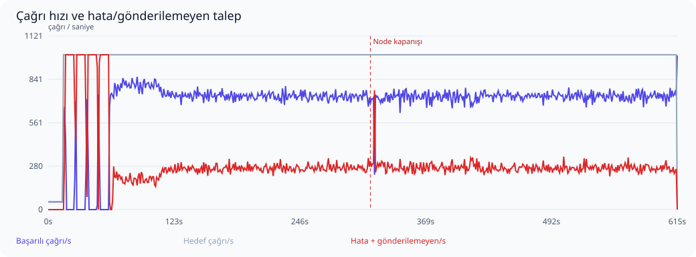
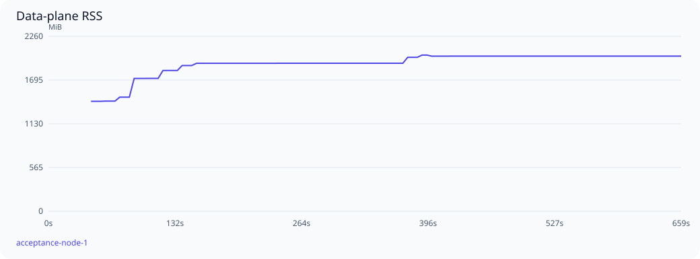

# MicroK8s üzerinde ölçek ve dayanıklılık testi

Başlangıç: 2026-11-05T16:55:33Z. Sonuç: **BULGU VAR / KABUL EŞİKLERİ KARŞILANMADI**.

PostgreSQL odaklı profil: 15 saniye ısınma ve 600 saniye 1000 TPS hedefi; önceden süresi dolmuş 100.000 operation/stream ile delivery temizliği de çalıştırılır. Bu koşu uzun soak veya fault kabul testi değildir. SQL süreleri ve beklemeler postgres-*.json dosyalarında bulunur.
Profil: **REST upstream**. Kaydedilmiş JSON operasyonları, request/response şema doğrulaması ve mevcut MCP istemci yolu kullanıldı.
Snapshot yayılımı bu koşuda ölçülmedi.

Envanter: 300 upstream, 300 virtual server, 60,000 tool tanımı/seçimi, 0 resource tanımı/seçimi; 600 kalıcı session, 64 yapılandırılmış agent key.

MicroK8s üzerinde ayrı test namespace’i: tek data-plane podu ve bir control-plane podu. Data plane başına GOMAXPROCS=8, GOMEMLIMIT=4GiB, 64 bağlantılık pool; Kubernetes CPU limiti 8, bellek limiti 6GiB. PostgreSQL CPU/bellek limiti yok; requests 2 CPU / 2GiB, Redis 1 CPU / 512MiB. Envanter ve yük sürücüsü host üzerinde; PostgreSQL/Redis ve uygulama Kubernetes üzerinde. Mevcut vmcp-demo değiştirilmedi.

300 mantıksal upstream adresi 16 sentetik HTTP fixture dinleyicisine dağıtılır. Tool yanıtı 5 ms geciktirilir. Her yanıtta doğru upstream rotası, tool adı, çağrı nonce’u ve PII maskesi doğrulanır. Bu gerçek upstream servislerinin kapasite veya ağ gecikmesi testi değildir.

Test proxy’si round-robin dağıtır, arızalı node için 10 saniyelik pasif bekleme uygular ve POST isteğini başka node’a tekrar göndermez. Üretim ingress’i/nginx bu koşunun parçası değildir. Bu odaklı koşuda pod kapatma yapılmaz; yük sırasında ayrı test key iptal edilir; PostgreSQL HA/failover kapsam dışıdır.

## Aşamalar

| Aşama | Hedef çağrı/s | Başarılı çağrı/s | Başarı % | p95 ms | p99 ms | Hata | Gönderilemeyen | Eşik |
|---|---:|---:|---:|---:|---:|---:|---:|---|
| Isınma | 50 | 50.0 | 100.000 | 21.1 | 31.3 | 0 | 0 | Geçti |
| Sabit yük | 1000 | 690.2 | 69.138 | 1412.8 | 1449.9 | 185131 | 125 | Karşılanmadı |

Yüzdelikler yalnızca başarılı çağrıların servis gecikmesidir; hatalar ayrıca sayılır. Başarı oranı gönderilen isteklere göre, çağrı/s ise kuyruk boşaltma dahil gerçek aşama süresine göre hesaplanır. Gönderilemeyen istekler de hedefin karşılanması değerlendirmesine dahildir. İstemci retry yapmaz.



## Tutarlılık ve güvenlik

- Başarılı istemci çağrısı: **415494**.
- Eşleşen kalıcı audit admission: **415494**.
- Eşleşen başarılı audit outcome: **415494**.
- Çift upstream çalıştırma: **0**.
- Outcome’u olmayan admission: **0**.
- Hatalı istemci çağrısıyla açıklanamayan eksik outcome: **0**.
- Çağrı alan farklı upstream: **300**.
- Çağrı alan farklı virtual server: **300**.
- Çağrı alan farklı virtual tool: **60000**.
- Çağrı yapan farklı agent key: **64**.

Node kapanışında kalıcı admission’dan sonra outcome yazılamamış olabilir. Bunlar yalnızca hatalı istemci isteğiyle eşleşiyorsa açıklanmış belirsiz işlemler olarak tutulur; başarılı sayılmaz veya yeniden çalıştırılmaz. Başarılı her istemci yanıtı için admission ve başarılı outcome ayrı ayrı doğrulanır.

- `cross_replica_polling_under_500ms`: geçti.
- `invalid_keys_rejected_on_both_nodes`: geçti.
- `key_revocation_propagated_and_rejected_on_single_node`: geçti.
- `key_revocation_under_load_within_5s`: geçti.
- `no_data_plane_restart_or_oom`: geçti.
- `session_termination_authoritative_on_both_nodes`: geçti.
- `single_node_session_and_paginated_masked_metadata`: geçti.

## Kaynak kullanımı

| Node | En yüksek RSS MiB | Medyan OS CPU % | Örneklenen DB pool tepe kullanımı | Pool edinim iptali (gözlenen en yüksek sayaç) | Soak RSS değişimi % |
|---|---:|---:|---:|---:|---:|
| acceptance-node-1 | 2017.5 | 196.6 | 64/64 | 0 | örnek yetersiz |



PostgreSQL: örneklenen bağlantı tepe sayısı **76 / 256**, deadlock **0**, lock bekleyen oturum tepe sayısı **0**. Test veritabanı boyutu ilk/son örnekte **205.3 / 1515.6 MiB**. Audit ve dayanıklı delivery kayıtları bu büyümeye dahildir.


RSS yaklaşık beş saniyede bir örneklenir; Go heap ile aynı değildir. RSS kubelet container RSS değeridir. CPU, kubelet usageNanoCores değerinden hesaplanan yakın dönem kullanımdır; önceki native ps ortalamasıyla aynı ölçüm değildir ve birden çok çekirdekte %100’ü aşabilir. Node yeniden başladığında sayaçlar sıfırlanır. Bu profilde rate-limit değerleri sınırsızdır; Redis limiter maliyeti ölçülmemiştir. Bu süre uzun dönemli bellek sızıntısının olmadığını kanıtlamaz.

Kaynak örneği: 124. Konteyner kaynağı örneği: 372. PostgreSQL connection, lock wait, deadlock, transaction ve disk boyutu örnekleri ham raporda bulunur. Metrik etiket taşmaları beklenen cardinality sınırıdır; tüm tool’lara ayrı seri ayrıldığı anlamına gelmez.

## Eşikler ve sınırlamalar

- Sabit yük: hedefin en az %99’i, gönderilenlerde en az %99,9 başarı; p95 ≤250 ms, p99 ≤1000 ms.
- Yük artışı: hedefin en az %80’i, en az %80 başarı; p99 <10 saniye ve bozuk sonuç olmaması.
- Node geçişi: aşamada en az %99 başarı; 10 saniyelik geçişten sonra hata ≤%0,1, p99 ≤1000 ms. Pasif sağlık kontrolü isteğinin hatası da sayılır.
- Node RSS ≤5 GiB; soak/etkin steady bellek büyümesi ≤%20. Container usage bütçesi: 5798205849 byte.
- Yerel, tek fiziksel makine ve tek PostgreSQL örneği. Üretim ağları, JWT/IdP yükü, kontrol düzlemi discovery/config churn, uzun çalışan gerçek araçlar ve veritabanı HA dahil değildir.

## Kabul bulguları

- steady capacity/latency SLO failed

## Tekrarlanabilirlik

Kaynak HEAD: `5d49db89e89de698bdfdeb4e0c8d04fdb918fc8b`; çalışma ağacındaki değişiklikleri içeren gerçek binary SHA-256: `aec33689b1b74972be52e9b26eb15951d7bb77b4aca62043a05ff9355798f09d`.
go1.27.3, linux/amd64. Ham örnekler ve sayaçlar: [Özet sonuçlar](summary.json); ham örnekler [yerel arşivde](../README.md#raw-artifacts).

```sh
VMCP_ACCEPTANCE_REST=1 python3 benchmark/kubernetes/run.py --database-focus --postgres-tuned --data-plane-cpus 8
```


## Yük sırasında key iptali

İlk 401: 4.220842861 s; bütçe 5 s. Readiness: True; reddin kararlılığı: True. Ham prob gözlemleri report.json içindedir.

PostgreSQL OLTP profili: shared_buffers=1GiB, effective_cache_size=4GiB, WAL buffers=32MiB, max_wal_size=4GiB, checkpoint=15min, daha sık autovacuum/analyze. fsync, synchronous_commit ve full_page_writes açık. Gerçek ayarlar: [postgres-effective-settings.json](diagnostics.json). Bu profil yalnızca izole benchmark kurulumu içindir.


## Yük altında farklı process üzerinden polling

Native host test veritabanına event yazar; gerçek data-plane podu GET SSE üzerinden okur. Local wake paylaşılmaz. Bu, tool çağrısı süresinden ayrı, yazım başlangıcından event’in client tarafından okunmasına kadar ölçümdür. İlk yük penceresinde yaklaşık saniyede bir 24 event; p50=249.51 ms, p95=250.729 ms, max=250.885 ms. Kabul bütçesi 500ms. Örnekleme, her koşulda 500ms garantisi değildir.

GET bağlantı hazırlığı: 1 deneme, 4.231 ms. Bu süre event teslimi ölçümünden ayrıdır; tool çağrılarında retry yoktur.


Ham örnekler ve loglar Git dışında tutulur. Arşiv kimliği ve SHA-256: [reproduction.json](reproduction.json). Bkz. [arşiv politikası](../README.md#raw-artifacts).
