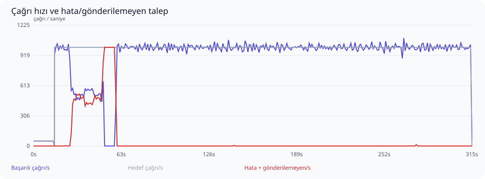
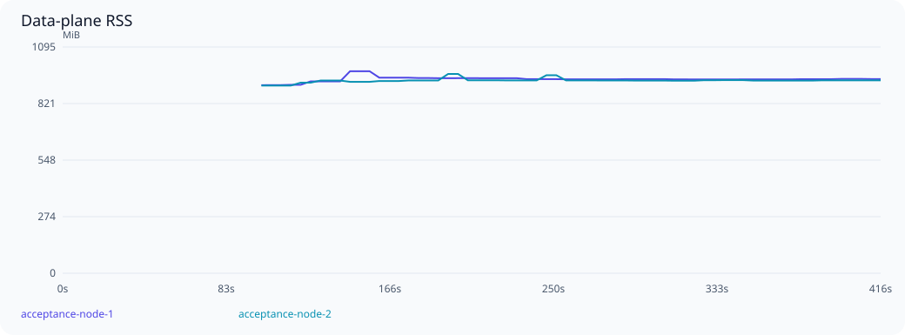

# MicroK8s üzerinde ölçek ve dayanıklılık testi

Başlangıç: 2026-10-23T18:04:11Z. Sonuç: **BULGU VAR / KABUL EŞİKLERİ KARŞILANMADI**.

PostgreSQL odaklı profil: 15 saniye ısınma ve 300 saniye 1.000 TPS hedefi; önceden süresi dolmuş 100.000 operation/stream ile delivery temizliği de çalıştırılır. Bu koşu uzun soak veya fault kabul testi değildir. SQL süreleri ve beklemeler postgres-*.json dosyalarında bulunur.
Profil: **REST upstream**. Kaydedilmiş JSON operasyonları, request/response şema doğrulaması ve mevcut MCP istemci yolu kullanıldı.
Snapshot yayılımı bu koşuda ölçülmedi.

Envanter: 300 upstream, 300 virtual server, 60,000 tool tanımı/seçimi, 0 resource tanımı/seçimi; 600 kalıcı session, 64 yapılandırılmış agent key.

MicroK8s üzerinde ayrı test namespace’i: iki data-plane podu ve bir control-plane podu. Data plane başına GOMAXPROCS=8, GOMEMLIMIT=768MiB, 64 bağlantılık pool; Kubernetes CPU limiti 8, bellek limiti 3GiB. PostgreSQL CPU/bellek limiti yok; requests 2 CPU / 2GiB, Redis 1 CPU / 512MiB. Envanter ve yük sürücüsü host üzerinde; PostgreSQL/Redis ve uygulama Kubernetes üzerinde. Mevcut vmcp-demo değiştirilmedi.

300 mantıksal upstream adresi 16 sentetik HTTP fixture dinleyicisine dağıtılır. Tool yanıtı 5 ms geciktirilir. Her yanıtta doğru upstream rotası, tool adı, çağrı nonce’u ve PII maskesi doğrulanır. Bu gerçek upstream servislerinin kapasite veya ağ gecikmesi testi değildir.

Test proxy’si round-robin dağıtır, arızalı node için 10 saniyelik pasif bekleme uygular ve POST isteğini başka node’a tekrar göndermez. Üretim ingress’i/nginx bu koşunun parçası değildir. Bu odaklı koşuda pod kapatma veya konfigürasyon mutasyonu yapılmaz; PostgreSQL HA/failover kapsam dışıdır.

## Aşamalar

| Aşama | Hedef çağrı/s | Başarılı çağrı/s | Başarı % | p95 ms | p99 ms | Hata | Gönderilemeyen | Eşik |
|---|---:|---:|---:|---:|---:|---:|---:|---|
| Isınma | 50 | 49.9 | 100.000 | 90.5 | 107.6 | 0 | 0 | Geçti |
| Sabit yük | 1000 | 933.4 | 96.782 | 162.0 | 1046.4 | 9311 | 10633 | Karşılanmadı |

Yüzdelikler yalnızca başarılı çağrıların servis gecikmesidir; hatalar ayrıca sayılır. Başarı oranı gönderilen isteklere göre, çağrı/s ise kuyruk boşaltma dahil gerçek aşama süresine göre hesaplanır. Gönderilemeyen istekler de hedefin karşılanması değerlendirmesine dahildir. İstemci retry yapmaz.



## Tutarlılık ve güvenlik

- Başarılı istemci çağrısı: **ölçülemedi**.
- Eşleşen kalıcı audit admission: **ölçülemedi**.
- Eşleşen başarılı audit outcome: **ölçülemedi**.
- Çift upstream çalıştırma: **ölçülemedi**.
- Outcome’u olmayan admission: **ölçülemedi**.
- Hatalı istemci çağrısıyla açıklanamayan eksik outcome: **ölçülemedi**.
- Çağrı alan farklı upstream: **ölçülemedi**.
- Çağrı alan farklı virtual server: **ölçülemedi**.
- Çağrı alan farklı virtual tool: **ölçülemedi**.
- Çağrı yapan farklı agent key: **ölçülemedi**.

Node kapanışında kalıcı admission’dan sonra outcome yazılamamış olabilir. Bunlar yalnızca hatalı istemci isteğiyle eşleşiyorsa açıklanmış belirsiz işlemler olarak tutulur; başarılı sayılmaz veya yeniden çalıştırılmaz. Başarılı her istemci yanıtı için admission ve başarılı outcome ayrı ayrı doğrulanır.

- `cross_node_session_and_paginated_masked_metadata`: geçti.
- `cross_replica_polling_under_500ms`: geçti.
- `invalid_keys_rejected_on_both_nodes`: geçti.
- `key_revocation_propagated_and_rejected_on_both_nodes`: karşılanmadı.
- `session_termination_authoritative_on_both_nodes`: geçti.

## Kaynak kullanımı

| Node | En yüksek RSS MiB | Medyan OS CPU % | Örneklenen DB pool tepe kullanımı | Pool edinim iptali (gözlenen en yüksek sayaç) | Soak RSS değişimi % |
|---|---:|---:|---:|---:|---:|
| acceptance-node-1 | 977.7 | 767.6 | 64/64 | 306 | örnek yetersiz |
| acceptance-node-2 | 964.6 | 768.3 | 29/64 | 0 | örnek yetersiz |



PostgreSQL: örneklenen bağlantı tepe sayısı **141 / 256**, deadlock **0**, lock bekleyen oturum tepe sayısı **0**. Test veritabanı boyutu ilk/son örnekte **192.9 / 853.2 MiB**. Audit ve dayanıklı delivery kayıtları bu büyümeye dahildir.


RSS yaklaşık beş saniyede bir örneklenir; Go heap ile aynı değildir. RSS kubelet container RSS değeridir. CPU, kubelet usageNanoCores değerinden hesaplanan yakın dönem kullanımdır; önceki native ps ortalamasıyla aynı ölçüm değildir ve birden çok çekirdekte %100’ü aşabilir. Node yeniden başladığında sayaçlar sıfırlanır. Bu profilde rate-limit değerleri sınırsızdır; Redis limiter maliyeti ölçülmemiştir. Bu süre uzun dönemli bellek sızıntısının olmadığını kanıtlamaz.

Kaynak örneği: 64. Konteyner kaynağı örneği: 192. PostgreSQL connection, lock wait, deadlock, transaction ve disk boyutu örnekleri ham raporda bulunur. Metrik etiket taşmaları beklenen cardinality sınırıdır; tüm tool’lara ayrı seri ayrıldığı anlamına gelmez.

## Eşikler ve sınırlamalar

- Sabit yük: hedefin en az %95’i, gönderilenlerde en az %99,9 başarı; p95 ≤250 ms, p99 ≤1000 ms.
- Yük artışı: hedefin en az %80’i, en az %80 başarı; p99 <10 saniye ve bozuk sonuç olmaması.
- Node geçişi: aşamada en az %99 başarı; 10 saniyelik geçişten sonra hata ≤%0,1, p99 ≤1000 ms. Pasif sağlık kontrolü isteğinin hatası da sayılır.
- Node RSS ≤1,5 GiB; soak ilk/son üçte birlik medyanları arasında artış ≤%20.
- Yerel, tek fiziksel makine ve tek PostgreSQL örneği. Üretim ağları, JWT/IdP yükü, kontrol düzlemi discovery/config churn, uzun çalışan gerçek araçlar ve veritabanı HA dahil değildir.

## Kabul bulguları

- steady capacity/latency SLO failed
- ERROR: could not resize shared memory segment "/PostgreSQL.3490393770" to 196736 bytes: No space left on device (SQLSTATE 53100)
- revoked key accepted or snapshot propagation timed out on acceptance-node-1
- revoked key accepted or snapshot propagation timed out on acceptance-node-2

## Tekrarlanabilirlik

Kaynak HEAD: `922c16eb3d6571fd11f65ff3add2fe1d0d4ad33d`; çalışma ağacındaki değişiklikleri içeren gerçek binary SHA-256: `7bf9ad921e93022a299b5cdd8b59ec2257bea1780605cc7a808aab7fc42091b6`.
go1.27.3, linux/amd64. Ham örnekler ve sayaçlar: [Özet sonuçlar](summary.json); ham örnekler [yerel arşivde](../README.md#raw-artifacts).

```sh
VMCP_ACCEPTANCE_REST=1 python3 benchmark/kubernetes/run.py --database-focus --data-plane-cpus 8
```


## Yük altında farklı process üzerinden polling

Native host test veritabanına event yazar; gerçek data-plane podu GET SSE üzerinden okur. Local wake paylaşılmaz. Bu, tool çağrısı süresinden ayrı, yazım başlangıcından event’in client tarafından okunmasına kadar ölçümdür. İlk yük penceresinde yaklaşık saniyede bir 24 event; p50=250.044 ms, p95=260.127 ms, max=304.337 ms. Kabul bütçesi 500ms. Örnekleme, her koşulda 500ms garantisi değildir.


Ham örnekler ve loglar Git dışında tutulur. Arşiv kimliği ve SHA-256: [reproduction.json](reproduction.json). Bkz. [arşiv politikası](../README.md#raw-artifacts).
