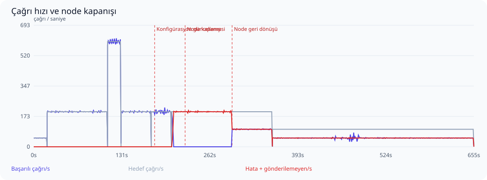
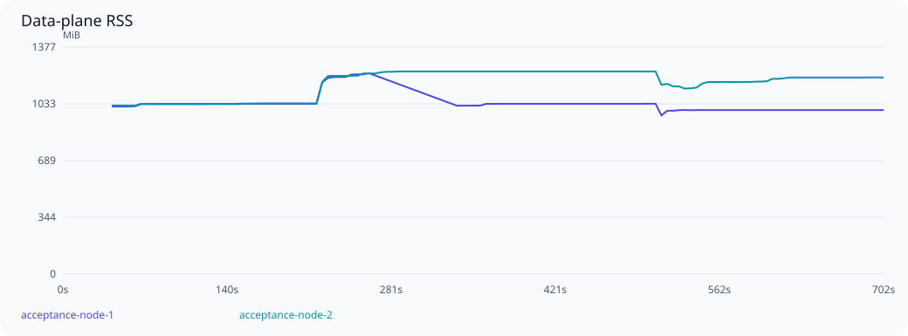

# Ölçek ve dayanıklılık kabul testi

Başlangıç: 2026-10-20T12:07:13Z. Sonuç: **BULGU VAR / KABUL EŞİKLERİ KARŞILANMADI**.

Profil: **REST upstream**. Kaydedilmiş JSON operasyonları, request/response şema doğrulaması ve mevcut MCP istemci yolu kullanıldı.
Trafik altında iki node'a snapshot yayılımı: **25329 ms**.

Envanter: 300 upstream, 300 virtual server, 60,000 tool tanımı/seçimi, 0 resource tanımı/seçimi; 600 kalıcı session, 64 yapılandırılmış agent key.

İki ayrı gerçek data-plane süreci; her birinde GOMAXPROCS=2, 768 MiB Go yumuşak bellek limiti ve 64 bağlantılık DB pool. Ayrı PostgreSQL 17 konteyneri 2 CPU / 2 GiB; ayrı Redis konteyneri 0,5 CPU / 256 MiB. Ana uygulama ortamına dokunulmadı.

300 mantıksal upstream adresi 16 sentetik HTTP fixture dinleyicisine dağıtılır. Tool yanıtı 5 ms geciktirilir. Her yanıtta doğru upstream rotası, tool adı, çağrı nonce’u ve PII maskesi doğrulanır. Bu gerçek upstream servislerinin kapasite veya ağ gecikmesi testi değildir.

Test proxy’si round-robin dağıtır, arızalı node için 10 saniyelik pasif bekleme uygular ve POST isteğini başka node’a tekrar göndermez. Üretim ingress’i/nginx bu koşunun parçası değildir. Node kaybı SIGKILL ile yapılır; PostgreSQL HA/failover kapsam dışıdır.

## Aşamalar

| Aşama | Hedef çağrı/s | Başarılı çağrı/s | Başarı % | p95 ms | p99 ms | Hata | Gönderilemeyen | Eşik |
|---|---:|---:|---:|---:|---:|---:|---:|---|
| Isınma | 50 | 50.0 | 100.000 | 51.7 | 63.7 | 0 | 0 | Geçti |
| Sabit yük | 200 | 200.0 | 100.000 | 46.0 | 52.2 | 0 | 0 | Geçti |
| Ani yük artışı | 600 | 599.2 | 100.000 | 62.0 | 71.4 | 0 | 0 | Geçti |
| Yük sonrası toparlanma | 200 | 199.8 | 100.000 | 45.9 | 51.0 | 0 | 0 | Geçti |
| config-refresh | 200 | 197.8 | 100.000 | 193.8 | 244.8 | 0 | 0 | Geçti |
| Node kaybı | 200 | 4.9 | 2.467 | 70.3 | 84.6 | 17556 | 0 | Karşılanmadı |
| Node geri dönüşü | 200 | 100.0 | 50.000 | 45.4 | 51.3 | 6000 | 0 | Karşılanmadı |
| Süreklilik | 100 | 50.0 | 50.000 | 163.5 | 554.1 | 15000 | 0 | Karşılanmadı |

Yüzdelikler yalnızca başarılı çağrıların servis gecikmesidir; hatalar ayrıca sayılır. Başarı oranı gönderilen isteklere göre, çağrı/s ise kuyruk boşaltma dahil gerçek aşama süresine göre hesaplanır. Gönderilemeyen istekler de hedefin karşılanması değerlendirmesine dahildir. İstemci retry yapmaz.



## Tutarlılık ve güvenlik

- Başarılı istemci çağrısı: **67444**.
- Eşleşen kalıcı audit admission: **67444**.
- Eşleşen başarılı audit outcome: **67444**.
- Çift upstream çalıştırma: **0**.
- Outcome’u olmayan admission: **0**.
- Hatalı istemci çağrısıyla açıklanamayan eksik outcome: **0**.
- Çağrı alan farklı upstream: **300**.
- Çağrı alan farklı virtual server: **300**.
- Çağrı alan farklı virtual tool: **41445**.
- Çağrı yapan farklı agent key: **64**.

Node kapanışında kalıcı admission’dan sonra outcome yazılamamış olabilir. Bunlar yalnızca hatalı istemci isteğiyle eşleşiyorsa açıklanmış belirsiz işlemler olarak tutulur; başarılı sayılmaz veya yeniden çalıştırılmaz. Başarılı her istemci yanıtı için admission ve başarılı outcome ayrı ayrı doğrulanır.

- `configuration_refresh_under_rest_load`: karşılanmadı.
- `cross_node_session_and_paginated_masked_metadata`: geçti.
- `invalid_keys_rejected_on_both_nodes`: karşılanmadı.
- `key_revocation_propagated_and_rejected_on_both_nodes`: karşılanmadı.
- `session_termination_authoritative_on_both_nodes`: karşılanmadı.

## Kaynak kullanımı

| Node | En yüksek RSS MiB | Medyan OS CPU % | Örneklenen DB pool tepe kullanımı | Pool edinim iptali (gözlenen en yüksek sayaç) | Soak RSS değişimi % |
|---|---:|---:|---:|---:|---:|
| acceptance-node-1 | 1219.0 | 169.4 | 27/64 | 0 | -3.7 |
| acceptance-node-2 | 1229.8 | 185.9 | 24/64 | 0 | -3.0 |



PostgreSQL: örneklenen bağlantı tepe sayısı **71 / 200**, deadlock **0**, lock bekleyen oturum tepe sayısı **3**. Test veritabanı boyutu ilk/son örnekte **158.0 / 315.6 MiB**. Audit ve dayanıklı delivery kayıtları bu büyümeye dahildir.


RSS yaklaşık beş saniyede bir örneklenir; Go heap ile aynı değildir. CPU yüzdesi işletim sisteminin süreç için raporladığı değerdir; birden çok çekirdekte %100’ü aşabilir. Node yeniden başladığında sayaçlar sıfırlanır. Bu profilde rate-limit değerleri sınırsızdır; Redis limiter maliyeti ölçülmemiştir. Kısa soak süresi uzun dönemli bellek sızıntısının olmadığını kanıtlamaz.

Kaynak örneği: 132. Konteyner kaynağı örneği: 264. PostgreSQL connection, lock wait, deadlock, transaction ve disk boyutu örnekleri ham raporda bulunur. Metrik etiket taşmaları beklenen cardinality sınırıdır; tüm tool’lara ayrı seri ayrıldığı anlamına gelmez.

## Eşikler ve sınırlamalar

- Sabit yük: hedefin en az %95’i, gönderilenlerde en az %99,9 başarı; p95 ≤250 ms, p99 ≤1000 ms.
- Yük artışı: hedefin en az %80’i, en az %80 başarı; p99 <10 saniye ve bozuk sonuç olmaması.
- Node geçişi: aşamada en az %99 başarı; 10 saniyelik geçişten sonra hata ≤%0,1, p99 ≤1000 ms. Pasif sağlık kontrolü isteğinin hatası da sayılır.
- Node RSS ≤1,5 GiB; soak ilk/son üçte birlik medyanları arasında artış ≤%20.
- Yerel, tek fiziksel makine ve tek PostgreSQL örneği. Üretim ağları, JWT/IdP yükü, kontrol düzlemi discovery/config churn, uzun çalışan gerçek araçlar ve veritabanı HA dahil değildir.

## Kabul bulguları

- REST configuration refresh did not reach both nodes
- node-loss capacity/latency SLO failed
- node-rejoin capacity/latency SLO failed
- soak capacity/latency SLO failed
- invalid key was not rejected
- terminated session accepted on acceptance-node-2
- revoked key accepted or snapshot propagation timed out on acceptance-node-1
- revoked key accepted or snapshot propagation timed out on acceptance-node-2

## Tekrarlanabilirlik

Kaynak HEAD: `1df9dab41964cb69354150b0a860dc1b6d998bb7`; çalışma ağacındaki değişiklikleri içeren gerçek binary SHA-256: `e9e7466b30947df28a89023c52043706f30383b643b780e5bc15590cf5236d22`.
go1.27.2, darwin/arm64. Ham örnekler ve sayaçlar: [report.json](report.json).

```sh
VMCP_ACCEPTANCE_REST=1 ./scripts/acceptance-core.sh
```
