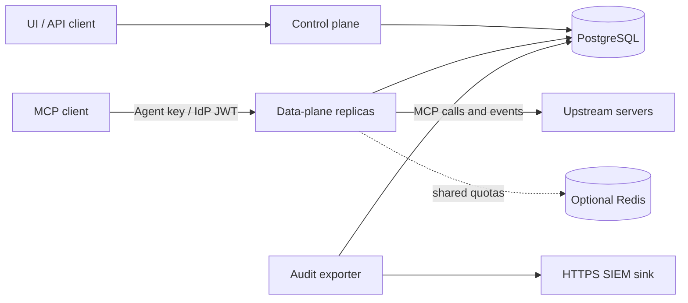

# Architecture

## Components

| Component | Responsibility |
|---|---|
| Control plane | OpenAPI REST management, tokens/OIDC roles, curated tools/catalog discovery, GitOps and transactional administrative audit |
| Data plane | June Streamable HTTP/SSE, principal/session authorization, policy/PII/quotas, upstream calls, bidirectional delivery and strict audit admission/outcome |
| Web UI | React/Vite/Tailwind management, selection editors, ETag conflicts, audit queries and GitOps |
| PostgreSQL | Configuration/revisions, session truth, delivery leases/encrypted replay, audit/receipts/holds and health; required availability dependency |
| Redis | Optional shared quota counters; local fallback or strict denial is an explicit operator choice |
| Operational commands | Coordinated migrations, restartable secret rotation, separate HTTPS audit exporter |
| Optional worker/router | Dedicated mTLS stdio owner workers and exact-host routing of dedicated tenant deployments |

## Configuration and sessions

Configuration writes bump a PostgreSQL revision. LISTEN/NOTIFY wakes snapshot
rebuilds; polling confirms freshness and recovers missed hints. Failed refreshes
retain the last snapshot but do not indefinitely renew authorization: stale nodes
fail closed. Operational rows do not trigger configuration reloads.

Session owners and initialization state live in PostgreSQL. Physical upstream
connections and caches remain local and are opened lazily; configuration/credential
fingerprints retire stale connections. Any gateway node can resolve a downstream
session. Shared fenced operation/event/reply records support SSE replay and routed
client requests without requiring load-balancer affinity. Physical connection state
and ambiguous external effects do not migrate or become exactly once.

## Protected request flow

1. Validate ingress, authenticate the principal and resolve session ownership against fresh configuration.
2. Enforce selected-object access, quotas, policy and configured privacy/approval checks.
3. Persist strict audit admission before protected upstream dispatch; administrative changes and their mutation records share a transaction.
4. Invoke the selected upstream with bounded resources/deadlines. Retry only under the defined idempotency/authorization rules; relay negotiated client requests and progress through fenced delivery.
5. Inspect/mask content and persist outcome. A missing outcome remains incomplete evidence; a failed client response does not prove the upstream side effect did not occur.

Some catalog rejection paths still lack equivalent decision audit coverage; see the
[production roadmap](../README.md#roadmap-to-production-readiness).

## Scope and deployment

Tools, resources/templates and prompts are explicitly curated. Upstreams use
Streamable HTTP, legacy HTTP+SSE or isolated stdio workers. Hosted tenants use
separate databases, processes, credentials and keys; internal SQL still selects
the dedicated database's `default` configuration row. Shared-schema tenant switching
and RLS are not implemented. See [tenant/worker boundaries](TENANT_AND_STDIO_OPERATIONS.md),
[delivery](MCP_DELIVERY.md), [client negotiation](MCP_CLIENT_FEATURES.md) and
[the runnable multi-node demo](../benchmark/README.md).
