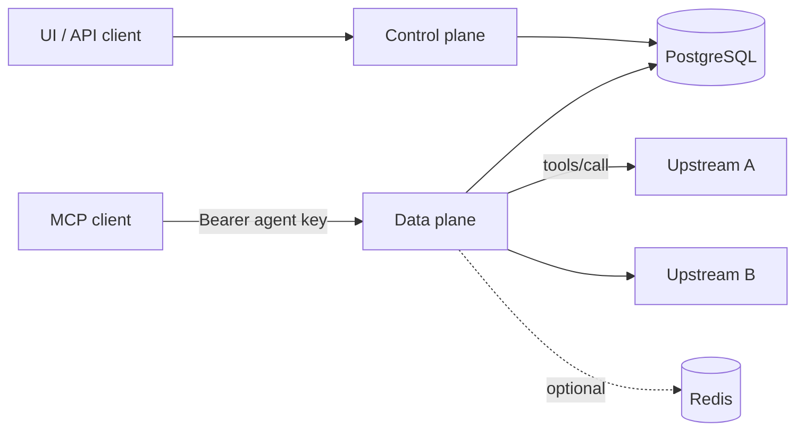

# Architecture

## Components

| Component | Responsibility |
|---|---|
| **Control plane** | REST API ([OpenAPI](https://github.com/bishoku/vmcp/blob/main/api/openapi.yaml)), authentication of admins (tokens, OIDC), runs database migrations, fetches upstream tool schemas |
| **Data plane** | Serves `/mcp/v1/virtual/{slug}` over Streamable HTTP, authenticates agent keys, applies policy/PII/rate limits, proxies calls, writes audit events |
| **Web UI** | Static React app talking to the control plane API |
| **PostgreSQL** | Configuration, sessions, audit, per-node upstream health. The only required dependency |
| **Redis** | Optional. Only shares rate-limit counters between data-plane nodes |

## How configuration reaches the data plane

Every configuration write bumps a revision in PostgreSQL. Data-plane nodes `LISTEN` for it, rebuild an immutable
in-memory **snapshot** and swap it atomically. No restart, no polling storm. Operational tables (audit, sessions,
health) do not trigger reloads.

## Sessions

The gateway keeps its own downstream session per agent (`Mcp-Session-Id`) and opens upstream sessions lazily. Session
records live in PostgreSQL, so any node can resume a session; its upstream sessions are re-established on first use.
Idle sessions expire after 30 minutes.

## Request flow for `tools/call`

1. Authenticate the agent key (if the virtual server requires it) and check its IP allowlist.
2. Enforce rate limits (key, then virtual server).
3. Enforce the tool policy; blocked tools do not exist for the agent.
4. Mask PII in arguments (if enabled), route to the owning upstream (circuit breaker, optional single retry for
   idempotent tools, failover URLs), mask PII in the result.
5. Write an audit event.

## Scope and non-goals

Tools only (no resources/prompts); Streamable HTTP and legacy HTTP+SSE upstreams (no stdio); one tenant (`default`,
the schema is prepared for more); no human-in-the-loop approvals.
