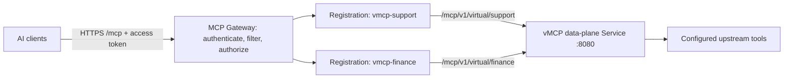
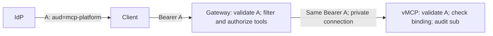
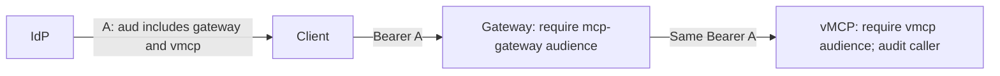
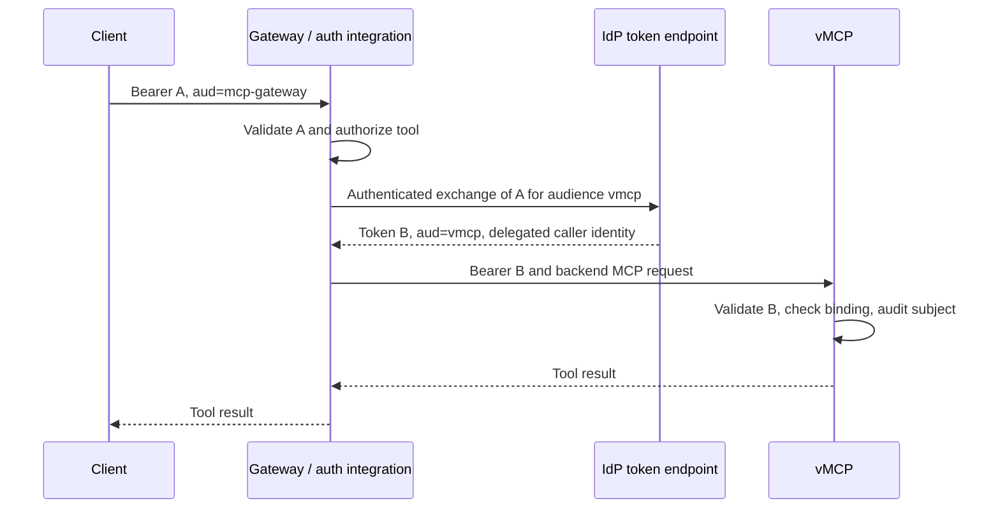
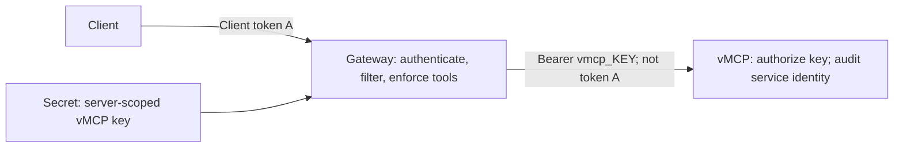

# OpenShift AI and MCP Gateway integration

Expose vMCP virtual servers through one OpenShift MCP Gateway endpoint. Clients
see and call tools according to their credentials; each vMCP slug is a separate
MCP backend even when all slugs share one data-plane Service.

This guide targets OpenShift AI 3.5 with a separately installed MCP Gateway. It
provides architecture and configuration templates, **not cluster-tested
compatibility certification**. Record and pin the operator, gateway image, CRD,
OpenShift and vMCP versions used in your deployment. An unpinned `latest` image
is not a compatibility contract.

## Compatibility and prerequisites

OpenShift AI 3.5 documents MCP Gateway Operator integration as a Technology
Preview external dependency with its own lifecycle. Check the support status of
the selected Red Hat package. OpenShift AI's version does not identify the
installed gateway CRD version. See the [3.5 release notes](https://docs.redhat.com/en/documentation/red_hat_openshift_ai_self-managed/3.5/html/release_notes/technology-preview-features_relnotes).

**Check protocol compatibility first.** vMCP advertises **2025-06-18**. Current
upstream gateway documentation describes 2025-11-25 and 2026-07-28 flows; that does
not establish acceptance of vMCP's June handshake. Verify the negotiated version
on both client-to-gateway and gateway-to-vMCP hops. If June backends are rejected,
resolve that incompatibility before rollout. Changing a header or declaring a
version in a registration does not implement protocol support. See the
[vMCP protocol contract](MCP_PROTOCOL_CONTRACT.md) and upstream
[multi-protocol guide](https://github.com/Kuadrant/mcp-gateway/blob/main/docs/guides/multi-protocol-support.md).

Inspect installed APIs before adapting examples:

```sh
oc get csv -A | grep -Ei 'mcp|kuadrant'
oc api-resources | grep -Ei 'mcp|gateway|httproute|authpolicy'
oc get crd mcpserverregistrations.mcp.kuadrant.io -o yaml
oc explain mcpserverregistration.spec --recursive
oc get gateway,httproute -A
oc get mcpgatewayextension -A
```

These examples use the current upstream `mcp.kuadrant.io/v1` registration shape
with `spec.prefix`. Earlier Red Hat examples use `mcp.kuadrant.io/v1alpha1` with
`spec.toolPrefix`; older community examples also use `mcp.kagenti.com`. Use the
served API and fields from your installed package, not a mixture. References:
[upstream registration guide](https://github.com/Kuadrant/mcp-gateway/blob/main/docs/guides/register-mcp-servers.md)
and [Red Hat registration reference](https://docs.redhat.com/en/documentation/red_hat_connectivity_link/1.3/html/registering_mcp_servers_and_creating_policies/mcp-gateway-register-on-prem-mcp-servers).

Start with a working Gateway, broker/router and `MCPGatewayExtension` targeting
that Gateway. A cross-namespace extension-to-Gateway reference needs the
operator's documented `ReferenceGrant`. Backend routes attach to the backend
listener (commonly `mcps`), whose `allowedRoutes` must permit the vMCP namespace.
Limit attachment to approved namespaces. This listener is distinct from the
public MCP listener and from OpenShift AI's model-serving gateway.

## Topology and endpoints



| Purpose | Example |
|---|---|
| Public client endpoint | `https://mcp.example.com/mcp` |
| Support backend | `http://vmcp-data-plane.vmcp.svc:8080/mcp/v1/virtual/support` |
| Finance backend | `http://vmcp-data-plane.vmcp.svc:8080/mcp/v1/virtual/finance` |
| Support registration identity | `vmcp/vmcp-support` |
| Finance registration identity | `vmcp/vmcp-finance` |

The backend URLs behave like two separately deployed MCP servers; separate pods
or Services are unnecessary. Clients use one public URL. A gateway
`MCPVirtualServer` is an optional curated view, not required for credential-based
access and not an authorization boundary. It is different from a
[vMCP virtual server](Virtual-Servers.md).

## Register each slug

These templates assume namespace `vmcp`, Service `vmcp-data-plane:8080`, Gateway
`gateway-system/mcp-gateway`, and backend listener `mcps` accepting `*.mcp.local`.
Replace names to match your installation. Helm's `fullnameOverride: vmcp`
produces the Service name used here; default release/chart naming can differ.

```yaml
apiVersion: gateway.networking.k8s.io/v1
kind: HTTPRoute
metadata:
  name: vmcp-support
  namespace: vmcp
spec:
  parentRefs:
    - name: mcp-gateway
      namespace: gateway-system
      sectionName: mcps
  hostnames:
    - vmcp-support.mcp.local
  rules:
    - matches:
        - path:
            type: Exact
            value: /mcp/v1/virtual/support
      backendRefs:
        - name: vmcp-data-plane
          port: 8080
---
apiVersion: mcp.kuadrant.io/v1
kind: MCPServerRegistration
metadata:
  name: vmcp-support
  namespace: vmcp
spec:
  targetRef:
    group: gateway.networking.k8s.io
    kind: HTTPRoute
    name: vmcp-support
  path: /mcp/v1/virtual/support
  prefix: support_
```

Keep the full path in both resources; no path rewrite is needed. The internal
hostname matches the backend listener and need not be publicly resolvable. Route
to the data plane, not the web UI or control plane. Keeping the registration,
route, Service and Secret in one namespace avoids extra references. Cross-namespace
Gateway attachment uses `allowedRoutes`; a cross-namespace backend Service
reference additionally needs a `ReferenceGrant`.

Repeat the pair for finance with name `vmcp-finance`, hostname
`vmcp-finance.mcp.local`, path `/mcp/v1/virtual/finance` and prefix `finance_`.
Keep the same Service. Choose stable, distinct prefixes. If vMCP exposes
`crm__find_customer`, the gateway name becomes `support_crm__find_customer`;
the examples below assume a vMCP alias `find_customer`.

Authentication is omitted from this base registration. Choose an identity option
below and configure discovery access before expecting a protected backend to work.

## Discovery, visibility and routing

The controller translates registrations/routes into gateway configuration; the
broker discovers backend capabilities. For stateful JSON-RPC calls, the router
resolves the prefixed name, removes the gateway prefix, selects the backend path
and handles backend session setup. `HTTPRoute` alone does not inspect JSON tool
names. See the [gateway architecture](https://docs.redhat.com/en/documentation/red_hat_connectivity_link/1.4/html/mcp_gateway/mcp-gateway-introduction).

For example, `support_find_customer` reaches the support endpoint as
`find_customer`. Configure both list-time filtering and call-time enforcement:
a tool hidden from `tools/list` must still be denied if a client guesses its name.

One documented claim convention is:

```json
{
  "resource_access": {
    "vmcp/vmcp-support": {
      "roles": ["tool:find_customer"]
    }
  }
}
```

Gateway policy translates claims into an allowed capability set and separately
authorizes calls. Registration identities are namespaced; roles refer to names
before the gateway prefix. The [upstream authorization guide](https://github.com/Kuadrant/mcp-gateway/blob/main/docs/guides/authorization.md)
shows Authorino/OPA capability filtering and CEL call checks. Use its complete
policy for your version, including delivery of allowed capabilities to the
broker. Adding JWT claims alone does not activate filtering. Router-generated
tool/server headers must not be trusted from arbitrary client input.

vMCP identity bindings authorize virtual-server access; they do not automatically
configure gateway tool ACLs. Manage both from a consistent IdP permission model,
with vMCP tool/invocation policies as additional checks. Forwarding the user's
token alone does not prove the gateway catalog is filtered for that user. If
using a release's user-specific discovery mode, validate its configuration,
cache partitioning and failure behavior separately.

## Identity options

All options can use one IdP. `iss` identifies the issuer, `sub` the caller, `aud`
the intended resource, and scopes/roles the permissions. A common issuer does
not automatically mean common audiences or synchronized permissions.

| Option | Client token audience | Credential reaching vMCP on a call | Best fit |
|---|---|---|---|
| A. One logical resource | `mcp-platform` | Original client token | One privately connected stack presented as one MCP API |
| B. Multiple audiences | `mcp-gateway`, `vmcp` | Original client token | Two deliberately trusted token recipients |
| C. Token exchange | `mcp-gateway` | New delegated token for `vmcp` | Separate resource boundaries and narrower backend permissions |
| D. Service credential | Gateway audience | vMCP agent key | Gateway owns user authorization; backend sees a service identity |

### A. One logical resource and one audience

Gateway and vMCP can be deployment layers of one protected MCP API. This is an
explicit architecture choice, not an automatic consequence of sharing a cluster.
Register that resource with the IdP, align client-facing OAuth metadata with it,
and require the same audience at both layers. The IdP may map the public resource
URI to an identifier such as `mcp-platform`.



Illustrative claims, not a usable access token:

```json
{
  "iss": "https://sso.example.com/realms/platform",
  "sub": "support-agent-123",
  "aud": "mcp-platform",
  "roles": ["support-agent"]
}
```

Helm values fragment, merged with normal installation values:

```yaml
runtime:
  agentOIDC:
    issuer: https://sso.example.com/realms/platform
    audience: mcp-platform
    algorithms: [RS256, ES256]
```

Require `mcp-platform` at the gateway too. vMCP independently checks signature,
issuer, expiry and bindings. No exchange is needed. Do not forward this token to
unrelated vMCP upstream APIs; configure their credentials separately. A common
audience does not prove traversal of the gateway: enforce the network boundary
below. See [OAuth resource indicators](https://www.rfc-editor.org/rfc/rfc8707.html)
and [MCP token security](https://modelcontextprotocol.io/docs/draft/tutorials/security/security_best_practices).

### B. One token with two explicit audiences

Have the IdP deliberately issue the token for both recipients:

```json
{
  "iss": "https://sso.example.com/realms/platform",
  "sub": "support-agent-123",
  "aud": ["mcp-gateway", "vmcp"],
  "roles": ["support-agent"]
}
```



Change `runtime.agentOIDC.audience` to `vmcp`. vMCP checks membership in the
`aud` list; it does not require a single-element list. Keep the same issuer and
configure the gateway to require `mcp-gateway`. No exchange occurs. This requires
IdP support and trust between both recipients because the bearer token works at
either. Do not disable audience validation. Validate MCP resource discovery and
client behavior for this OAuth design as well.

### C. Separate audiences with token exchange



The IdP issues B. A gateway-side auth integration requests it before the backend
call; vMCP validates it. This requires an exchange implementation and IdP
delegation policy, not just an `HTTPRoute` or a registration field. A conceptual
RFC 8693 request contains:

```text
grant_type=urn:ietf:params:oauth:grant-type:token-exchange
subject_token=<TOKEN_A>
subject_token_type=urn:ietf:params:oauth:token-type:access_token
audience=vmcp
```

Authenticate the exchanging workload to the IdP. Restrict target audiences and
scopes; define whether `sub` is preserved and how actor identity is recorded.
vMCP bindings must match B's actual claims. Set `runtime.agentOIDC.audience` to
`vmcp` and inject B into backend `Authorization`. Fail closed on exchange failure;
partition any token cache by caller, audience and permissions, bounded by expiry.
Never edit an already signed token. See [OAuth Token Exchange](https://www.rfc-editor.org/rfc/rfc8693.html).

### D. Gateway identity at vMCP



Create a vMCP agent key assigned only to `support`. Store it through your secret
management process; the following is a placeholder, not a real credential:

```yaml
apiVersion: v1
kind: Secret
metadata:
  name: vmcp-support-credential
  namespace: vmcp
  labels:
    mcp.kuadrant.io/secret: "true"
type: Opaque
stringData:
  token: vmcp_REPLACE_WITH_SERVER_SCOPED_KEY
```

Registration `spec` fragment (verify the installed schema):

```yaml
credentialRef:
  name: vmcp-support-credential
  key: token
```

The referenced credential is documented for broker backend connections. Verify
call-time credential injection too: successful discovery alone does not prove
router behavior. vMCP expects `Authorization: Bearer vmcp_...`. vMCP audits the
service key; user identity remains at the gateway. Correlation metadata can link
records but is not authenticated end-user identity. See [agent keys](Agent-Keys-and-Authentication.md).

## Token forwarding, discovery and sessions

For A/B, Red Hat documents a backend-route policy preserving the Authorization
header. This is **only a forwarding fragment**, not a complete security policy:

```yaml
apiVersion: kuadrant.io/v1
kind: AuthPolicy
metadata:
  name: vmcp-support-forward-token
  namespace: vmcp
spec:
  targetRef:
    group: gateway.networking.k8s.io
    kind: HTTPRoute
    name: vmcp-support
  rules:
    response:
      success:
        headers:
          authorization:
            plain:
              expression: 'request.headers["authorization"]'
```

Integrate this with your gateway's policy inheritance/header-handling rules.
Ensure the header at that point is the validated client token, not a discovery
credential or overwritten internal header. C injects the exchanged token through
its integration; D uses the server key. Avoid competing policies writing
`Authorization`. Reference: [Red Hat backend authentication](https://docs.redhat.com/en/documentation/red_hat_connectivity_link/1.3/html/registering_mcp_servers_and_creating_policies/mcp-gateway-register-ext-mcp-servers).

Discovery may run before a client connects. Protected vMCP endpoints need a
discovery identity, or a verified user-specific discovery mode. A/B/C do not
remove that requirement. Decide separately how the broker reads the catalog and
how runtime calls authenticate. A discovery credential must not silently replace
the caller on runtime requests.

vMCP binds sessions to the slug and authenticated owner. A session initialized
with a service key cannot be reused with a user's JWT. Runtime `initialize`,
`notifications/initialized`, calls, streams and DELETE must maintain ownership.
Confirm isolation between users, registrations and auth modes in gateway session
and catalog caches. If the selected release cannot separate discovery/runtime
identity correctly, A/B/C require integration work; the forwarding fragment alone
is not a working solution.

Keep `authRequired` enabled. Create vMCP identity bindings through the Identities
UI or API, for example (this is not a Kubernetes CR):

```json
{
  "slug": "support-agents",
  "conditions": [{"claim": "roles", "op": "contains", "value": "support-agent"}],
  "virtualServers": ["support"],
  "enabled": true
}
```

See [OAuth for agents](OAuth-for-Agents.md) and
[authorization/session consistency](AUTHORIZATION_CONSISTENCY.md).

## OpenShift deployment boundary

Use the [Helm quickstart](HELM_QUICKSTART.md) for images, database, secrets and
migrations. Keep the data plane private; manage UI/control-plane access
separately. `ClusterIP` alone does not block other cluster workloads. Audience
validation checks a token's target, not its network path.

This illustrative policy admits selected gateway workloads. Replace the custom
label with verified selectors for the actual gateway Envoy and, if needed,
broker egress workloads. Protect label assignment. Namespace and pod selectors
in one peer form an AND condition.

```yaml
apiVersion: networking.k8s.io/v1
kind: NetworkPolicy
metadata:
  name: vmcp-data-plane-from-gateway
  namespace: vmcp
spec:
  podSelector:
    matchLabels:
      app.kubernetes.io/name: vmcp
      app.kubernetes.io/instance: vmcp
      app.kubernetes.io/component: data-plane
  policyTypes: [Ingress]
  ingress:
    - from:
        - namespaceSelector:
            matchLabels:
              kubernetes.io/metadata.name: gateway-system
          podSelector:
            matchLabels:
              integration.example.com/vmcp-caller: "true"
      ports:
        - protocol: TCP
          port: 8080
```

NetworkPolicies are additive: this cannot cancel a broader allow elsewhere. The
chart already generates policies with internal component access and optional
monitoring access on port 8080. Reconcile those and `networkPolicy.ingressFrom`
with the intended boundary, including the actual broker source namespace. For
strict gateway-only tool access while retaining health/metrics access, add L7 or
mesh authorization: NetworkPolicy cannot distinguish URL paths sharing a port.
Use mTLS/workload identity when cryptographic peer authentication is required.
Do not expose the backend listener as a public bypass around gateway policy.

Allow required egress for DNS, PostgreSQL, IdP discovery/JWKS, upstreams and
telemetry. Use TLS publicly and the required internal encryption policy; internal
HTTP examples do not install mTLS. Configure trusted proxies from actual proxy
networks, not all addresses.

The chart pins UID/GID/fsGroup `65532`. OpenShift restricted SCCs usually allocate
a namespace-specific range. This Helm overlay removes the fixed values so
admission can supply permitted identities:

```yaml
fullnameOverride: vmcp
ingress:
  enabled: false
workloadDefaults:
  podSecurityContext:
    runAsNonRoot: true
    runAsUser: null
    runAsGroup: null
    fsGroup: null
    seccompProfile:
      type: RuntimeDefault
```

Inspect rendered Deployments and the migration Job; confirm fixed values are
absent and check component overrides/dependency charts separately. Test startup
and writable volumes with the assigned UID. Preserve non-root, dropped-capability
and read-only-root-filesystem settings. This overlay does not certify dependency
images for restricted SCCs. See [OpenShift SCC behavior](https://docs.redhat.com/en/documentation/openshift_container_platform/4.22/pdf/authentication_and_authorization/managing-pod-security-policies).

## Validation and troubleshooting

Validate manifests against your installed schemas:

```sh
oc apply --dry-run=server -f vmcp-support.yaml
oc describe httproute vmcp-support -n vmcp
oc describe mcpserverregistration vmcp-support -n vmcp
oc get endpointslices -n vmcp -l kubernetes.io/service-name=vmcp-data-plane
```

Check route `Accepted`/`ResolvedRefs`, extension readiness and backend endpoints.
Current upstream registration `Ready` means configuration was written; discovery
is asynchronous. Verify actual tool availability, not only registration status.

Use an MCP client/Inspector with the public URL and two identities. Do not log
raw tokens. For vMCP's stateful hop verify `initialize`, the returned revision and
session, `notifications/initialized`, `tools/list`, an allowed call and DELETE.
Preserve negotiated `MCP-Protocol-Version`, `Mcp-Session-Id` and Accept headers.
Gateway and backend session IDs need not be identical.

| Test | Required result |
|---|---|
| Protocol negotiation | Gateway accepts vMCP's supported revision; otherwise stop rollout |
| Support-only identity lists tools | Support permissions visible; finance permissions absent |
| Guessed finance tool call | Denied even though the name is known |
| Missing/expired token or wrong issuer/audience | Denied without fallback to a privileged discovery key |
| A/B backend identity | Original caller subject verified by vMCP |
| C backend identity | Claims/subject follow the delegation contract |
| D backend identity | Service key recorded; no claim of end-user authentication at vMCP |
| Another user's backend session reused | Rejected; no mixed credentials or catalog caches |
| Role removal, token refresh, key rotation | Defined convergence bound without unintended stale privileges |
| Unrelated pod calls vMCP directly | Blocked by network/workload policy |
| Restart or long-running/SSE call | Correct recovery/timeouts; no automatic replay of side effects |

vMCP shares sessions through PostgreSQL; affinity is an optimization. JWT role
changes may require token renewal: a common IdP does not modify existing signed
claims. See [HA](Resilience-and-HA.md) and
[authorization consistency](AUTHORIZATION_CONSISTENCY.md).

For `404`, check slug and session owner; for `401`, check credential selection,
issuer, audience and expiry; for `403`, inspect gateway ACLs and vMCP bindings
independently. Missing tools may indicate protocol filtering or discovery failure.
Test resources, prompts, notifications, sampling and elicitation separately if
used; tool interoperability does not prove all feature families work.

## Operations and ownership

Keep catalog curation/upstream credentials in vMCP and client-facing
list filtering/call authorization at the MCP Gateway. A/B/C also let vMCP verify
caller identity and record the subject. Creating or changing a slug does not
reconcile Kubernetes resources automatically: manage routes, registrations,
credentials and policies through your deployment workflow.

For one privately connected product, evaluate A first. Choose B for intentional
multi-audience issuance, C for distinct delegation boundaries, or D when backend
service attribution is sufficient. Adopt the selected option only after protocol,
identity and session validation passes.
